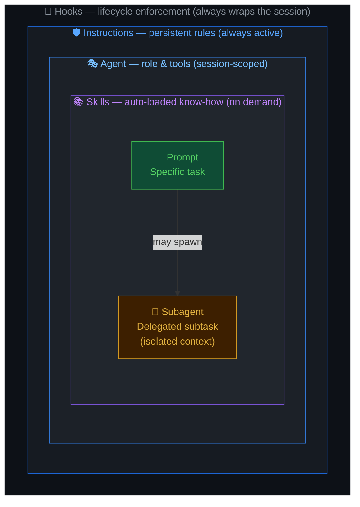
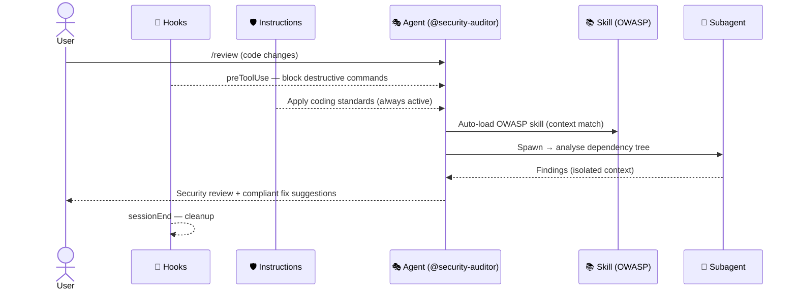

---
description: 'Understanding how Instructions, Agents, Prompts, Skills, Subagents, and Hooks work together in GitHub Copilot'
---

## Shared Mental Model

To get the most out of GitHub Copilot, it helps to understand how the different configuration options work together.

We use a simple mental model to distinguish between **Instructions**, **Agents**, **Prompts**, **Skills**, **Subagents**, and **Hooks**:

---

## The Model

- **Instructions** → Define the **Rules** (Persistent)
- **Agent** → Defines the **Role** (Session-level)
- **Prompt** → Defines the **Task** (Single interaction)
- **Skill** → Provides **Specialized Know-how** (Auto-loaded when relevant)
- **Subagent** → Handles a **Delegated Subtask** (Isolated context)
- **Hook** → Enforces **Lifecycle Actions** (Deterministic, event-driven)

---

### 1. Instructions: The Guardrails (The "How")
Instructions are the foundation. They define the "how" of your project—the standards, patterns, and rules that should *always* apply.

- **Analogy:** The company handbook or the project's style guide.
- **Example:** "Always use TypeScript," "Prefer async/await," "No semi-colons."
- **Persistence:** High. They are always active in the background.

### 2. Agents: The Experts (The "Who")
Agents set the persona and context for a conversation. They determine the expertise and the tools Copilot brings to the table.

- **Analogy:** Hiring a specialist (e.g., a Security Consultant or a DevOps Engineer).
- **Example:** `@workspace` (the expert on your code), `@security-auditor` (the expert on risks).
- **Persistence:** Medium. They stay active for the duration of a chat session.

### 3. Prompts: The Actions (The "What")
Prompts are specific, repeatable tasks. They are the immediate actions you want Copilot to perform right now.

- **Analogy:** A ticket in a sprint or a specific request to a colleague.
- **Example:** `/explain-code`, `/generate-tests`, `/review-changes`.
- **Persistence:** Low. They apply only to the current message.

### 4. Skills: The Specialized Playbooks (The "How to do X well")
Skills are folders of instructions and scripts that Copilot automatically loads when relevant to improve performance on specialized tasks.

- **Analogy:** A team runbook or standard operating procedure for a specific workflow.
- **Example:** A skill for debugging GitHub Actions failures, or deploying a service.
- **Trigger:** Automatic (Copilot selects based on context) or explicit (`Use the /skill-name skill`).
- **Persistence:** Loaded on demand; not always active.

### 5. Subagents: The Delegates (The "Who handles this subtask")
Subagents are isolated agent instances spawned by the main agent to handle delegated work in a separate context window.

- **Analogy:** Delegating a research task to a colleague so they can report back without interrupting your main work.
- **Example:** Spawn a subagent to analyze a large codebase, then use the result in the main session.
- **Trigger:** Automatic (by the main agent) or explicit in the prompt.
- **Limitation:** Subagents cannot create further subagents.

### 6. Hooks: The Guardrails at the Gate (The "What must always happen")
Hooks are shell commands that run deterministically at specific lifecycle events in the agent's workflow.

- **Analogy:** CI/CD pipeline steps that always run regardless of who triggers the pipeline.
- **Example:** A `preToolUse` hook that blocks dangerous shell commands; a `sessionEnd` hook that cleans up temp files.
- **Trigger:** Automatic at configured lifecycle events.

---

## How They Work Together

When you interact with Copilot, all layers can influence the result:

1. **Instructions** provide the global constraints.
2. **The Agent** provides the perspective and tools.
3. **The Prompt** provides the specific objective.
4. **Skills** provide specialized know-how when the task matches.
5. **Subagents** handle complex delegated subtasks in isolation.
6. **Hooks** enforce policies and automation at key lifecycle points.

**Example Scenario:**
> You use the `/review` prompt while the `@security-auditor` agent is active.
>
> - **The Prompt (`/review`)** tells Copilot to look at your code and find issues.
> - **The Agent (`@security-auditor`)** ensures the review focuses on vulnerabilities and risks.
> - **The Instructions (`copilot-instructions.md`)** ensure that any suggested fixes follow your project's coding standards.
> - **A Skill** for OWASP scanning is automatically loaded because the context matches.
> - **A Subagent** is spawned to analyze a large dependency tree without cluttering the main session.
> - **A Hook (`preToolUse`)** prevents the agent from running destructive shell commands during the review.

---

## Summary Table

| Layer            | Focus                    | Persistence   | Trigger                      |
| :--------------- | :----------------------- | :------------ | :--------------------------- |
| **Instructions** | Rules                    | Persistent    | Automatic                    |
| **Agents**       | Roles                    | Session       | Manual (`@`)                 |
| **Prompts**      | Tasks                    | Single Action | Manual (`/`)                 |
| **Skills**       | Specialized Know-how     | On Demand     | Auto (context) or explicit   |
| **Subagents**    | Delegated Subtasks       | Task Duration | Auto (agent) or explicit     |
| **Hooks**        | Lifecycle Enforcement    | Always        | Automatic (lifecycle events) |
