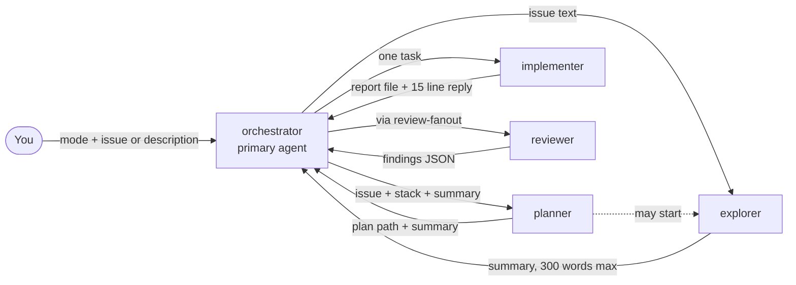
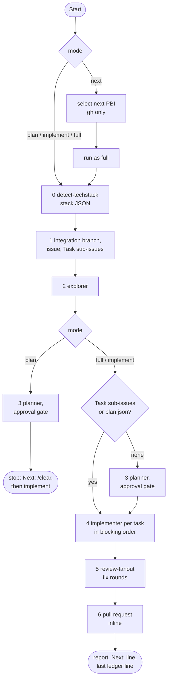
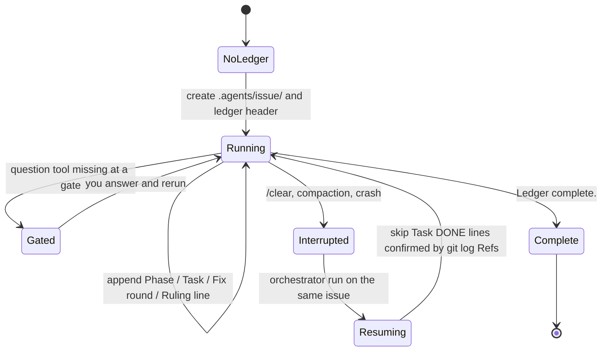
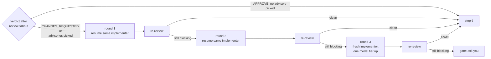
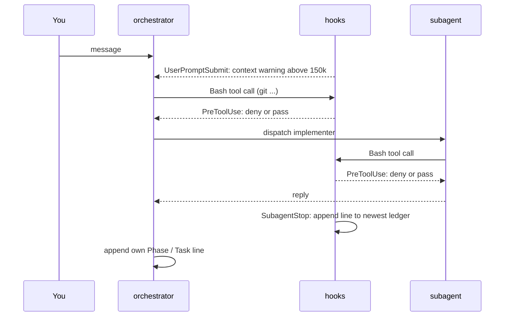

# How the orchestrator works

This page explains the internals of the `orchestrator` agent: who the five agents are, what travels between them, where the state lives, how gates and rulings differ, what the hooks do and how a run ends. It explains; it does not restate the rules. Each section links to the file that owns them. For how to start and use it, read the user walkthrough [The orchestrator](../orchestrator.md) and the operating procedure [Working mode](../working-mode.md).

## Architecture

The `agents` package ships one primary agent and four subagents. The orchestrator keeps only phase summaries (at most 300 words each) in its context; everything that reads code or produces a diff happens in a subagent that starts with an empty context and returns a short reply.

The diagram shows delegation and what comes back. The `planner` may start an `explorer` itself when the orchestrator passes no exploration summary; no other subagent starts subagents.

| Agent | Default model (Claude Code) | Tools | Output contract | Why an agent and not a skill |
|:--|:--|:--|:--|:--|
| [`orchestrator`](../../packages/agents/.apm/agents/orchestrator.agent.md) | inherit | Agent, Read, Grep, Glob, Bash, Skill, AskUserQuestion, SendMessage | phase summaries, PR URL, rulings verbatim | primary-agent entry point; asks the user at gates |
| [`explorer`](../../packages/agents/.apm/agents/explorer.agent.md) | haiku | Read, Grep, Glob | at most 300 words, `path:line` bullets | cheap model and no write or run tools |
| [`planner`](../../packages/agents/.apm/agents/planner.agent.md) | inherit | Read, Grep, Glob, Bash, Skill, Agent | `Plan: .agents/<issue>/plan.json`, at most 10 summary lines, `Open questions: <n>` | read-only on code and GitHub; may only write under `.agents/<issue>/` |
| [`implementer`](../../packages/agents/.apm/agents/implementer.agent.md) | sonnet | Read, Edit, Write, Grep, Glob, Bash, Skill | report file `.agents/<issue>/task-<n>-report.md` plus a reply of at most 15 lines starting with `Status:` | fresh context per task; `implementation` skill preloaded |
| [`reviewer`](../../packages/agents/.apm/agents/reviewer.agent.md) | sonnet | Read, Grep, Glob, Bash (git diff/log/show and the test command on OpenCode) | JSON array of findings, one dimension per instance | read-only, one dimension each, runs in parallel |

An agent is justified only by a model per role, a host-enforced tool set, an output contract or a primary-agent entry point; the procedures themselves are skills (`issue-planning`, `implementation`, `review-fanout`, `code-review`, `detect-techstack`, `github-pull-request`). The orchestrator runs `detect-techstack` and the pull request step inline in its own context; every other phase is a subagent. Source format and per-client mapping: [Agent frontmatter](agent-frontmatter.md).

## Pipeline

The first word of the message selects the mode: `plan`, `implement`, `full` (the default) or `next`. `next <feature|epic>` selects one PBI per [next-selection.md](../../packages/github/.apm/skills/github-issue/references/next-selection.md) and then runs it as `full`. Exactly one PBI per run.

The flowchart shows the six steps and where each mode leaves or joins them: `plan` always runs the planner and stops after its gate; `full` and `implement` run the planner only when the issue has no Task sub-issues (open or closed) and no `plan.json`. When all tasks are already merged step 4 is skipped too ([task-issues.md](../../packages/github/.apm/skills/github-issue/references/task-issues.md)).

What enters and leaves the orchestrator context at each step:

| Step | Runs in | Enters the orchestrator context | Stays outside |
|:--|:--|:--|:--|
| 0 Tech stack | orchestrator (inline skill) | the JSON report | |
| 1 Resolve | orchestrator | issue title, body, labels, `task` sub-issue numbers and states | |
| 2 Explore | `explorer` | summary, 300 words max | all files read |
| 3 Plan | `planner` | plan path, summary, open question count | `plan.json`, `plan.md` on disk |
| 4 Implement | `implementer` per task | the reply (`Status`, SHAs, one test line) | diff, logs, the report file |
| 5 Review | `review-fanout`, `reviewer` | verdict and finding lines | package file `review-<n>.diff`, `review.json` |
| 6 PR | orchestrator (`github-pull-request`) | PR URL | |

Commits are made in step 4 by the implementer on the PBI's single branch. Task sub-issues never get their own branch or PR. Steps and their wording: [orchestrator.agent.md](../../packages/agents/.apm/agents/orchestrator.agent.md), planning rules: [issue-planning](../../packages/delivery/.apm/skills/issue-planning/SKILL.md), review: [review-fanout](../../packages/delivery/.apm/skills/review-fanout/SKILL.md), branch choice: [release-branches.md](../../packages/github/.apm/skills/github-issue/references/release-branches.md). The user-facing walkthrough of each phase is in [The orchestrator](../orchestrator.md#the-pipeline).

## State

A run keeps its state on disk and on GitHub, never in the model's memory, so a `/clear`, a compaction or a crash loses nothing that matters. Everything lives under `.agents/<issue>/` (added to `.git/info/exclude` when not ignored).

| File | Written by | Purpose |
|:--|:--|:--|
| `progress.md` | orchestrator and the `SubagentStop` hook | the ledger: phase, task, fix round and ruling lines, plus one line per finished subagent |
| `plan.json`, `plan.md` | `planner` | plan items with sizes, blockers and open questions; `plan.md` is the human view |
| `task-<n>-report.md` | `implementer` | full report per task; `<n>` is the Task issue number, or the plan id (`p1`) for a single task without an issue |
| `review-<n>.diff`, `review.json` | `review-fanout` | the review package the reviewers read, and the machine-readable verdict |

Two values anchor the review range. `BASE` is `git rev-parse HEAD` before each task (never `HEAD~1`). `<first BASE>` is the `BASE` of the first task and starts the range `<first BASE>..HEAD` that goes to review; without a ledger it is `git merge-base HEAD origin/<integration-branch>`.

The Task issues are the source of truth and `plan.json` is a local cache of their numbers. A plan change edits the Task issue or adds one, then the cache. A task counts as merged when a commit with the footer `Refs #<task>` is reachable from the remote integration branch; the orchestrator then closes the issue and skips it. The exact grep is in [task-issues.md](../../packages/github/.apm/skills/github-issue/references/task-issues.md).

The diagram shows the life of a ledger. On resume the orchestrator reads the same-issue ledger, continues at the first phase without `complete`, says so in one line and trusts the ledger and `git log` over its own memory. A ledger of another issue stays untouched. Description input (`plan "add dark mode"`) keeps its state in `.agents/adhoc/` until the PBI exists, then moves it to `.agents/<issue>/` ([orchestrator-gates.md](../../packages/github/.apm/skills/github-issue/references/orchestrator-gates.md)).

## Gates and rulings

Two things look alike but are not the same.

- A **gate** is a decision that belongs to you: approving the plan (and grilling its open questions), choosing which review advisories to fix, a review that stays blocked after the fix rounds, and tests that fail twice. The orchestrator always asks; it never decides a gate itself.
- A **ruling** is a call the orchestrator makes alone inside its remit, for example the stack guess after an invalid `detect-techstack` report or the model for a docs task. It records the decision, the reason and the cost if wrong as a `Ruling:` ledger line and repeats every ruling in the final report ([orchestrator.agent.md](../../packages/agents/.apm/agents/orchestrator.agent.md)). A ruling never replaces a gate.

Without a question tool (a headless run) the orchestrator appends `Gate: <question>` to the ledger, reports it and stops; it never guesses. The issue overview and the review summary are the two default outputs that end in such a question; flags switch them off ([orchestrator-gates.md](../../packages/github/.apm/skills/github-issue/references/orchestrator-gates.md)).

Fix rounds follow a `CHANGES_REQUESTED` verdict, or selected advisories. They run on the blocking and selected findings:

The diagram shows how a verdict leads to at most three fix rounds, each followed by a re-review, before the question goes to you.

Rounds 1 and 2 resume the same implementer (Claude Code `SendMessage` to its agent id, OpenCode resumes the task); Copilot subagents are stateless, so there a fresh implementer gets the findings and the report path. Clearing before implementation is a recommendation, not a gate: a `plan` run always ends by recommending `/clear` and then `orchestrator implement <issue>`, and a `full` run asks once after the plan gate when the context is above 100k tokens. The orchestrator never clears for you ([Clear before implement](../../packages/github/.apm/skills/github-issue/references/orchestrator-gates.md)).

## Hooks

The `hooks` package adds three hooks around the orchestrator. They are plain bash scripts that never fail a run: every path exits 0 and a payload they cannot parse is ignored. The orchestrator does not call them and does not depend on them; they make the state on disk more complete and protect against accidents.

| Hook | Event | Reads from the payload | Writes or blocks | Opt-out |
|:--|:--|:--|:--|:--|
| [`subagent-ledger.sh`](../../packages/hooks/.apm/hooks/subagent-ledger.sh) | `SubagentStop` | `cwd`, `agent_type` (also `agentType`, `agentName`, `subagent_type`), `last_assistant_message` or `response`, `agent_transcript_path` | appends `Subagent <name>: stopped — <first line, 120 chars>` to a ledger; only when a ledger exists, which the orchestrator creates | none |
| [`context-warning.sh`](../../packages/hooks/.apm/hooks/context-warning.sh) | `UserPromptSubmit` | `transcript_path`, `session_id` | injects an `additionalContext` warning once the last request has at least 150k tokens (`CONTEXT_WARN_TOKENS`), again after +100k (`CONTEXT_WARN_STEP`) | none; raise `CONTEXT_WARN_TOKENS` to silence it |
| [`git-guardrails.sh`](../../packages/hooks/.apm/hooks/git-guardrails.sh) | `PreToolUse`, matcher `Bash` | `tool_name`, `cwd`, `tool_input.command` | prints a `permissionDecision: deny` JSON with the reason; nothing for allowed commands | `GIT_GUARDRAILS_OFF=1` or `.agents/guardrails.off` |

The diagram shows where each hook fires: the guard sits in front of every Bash call of the orchestrator and of the subagents, the ledger hook fires when a subagent stops, and the context warning fires when you send a message.

Behaviour you should know about, verified against the scripts:

- **The ledger hook picks the newest ledger, not necessarily the issue's.** It appends to `$AGENTS_LEDGER` when set, otherwise to the most recently modified `.agents/*/progress.md` under `cwd`. It writes nothing when no ledger exists. With two issues in one working tree the line can land in the wrong one; the same limit is noted for description runs in [orchestrator-gates.md](../../packages/github/.apm/skills/github-issue/references/orchestrator-gates.md).
- It skips the orchestrator itself (the agent name `orchestrator`, in any case and with a namespace such as `plugin:orchestrator`), because the orchestrator writes its own lines. It does not append the same line twice in a row. When the payload has no summary it falls back to the last line of the subagent transcript and, for the `implementer`, to the path of a task report touched in the last 10 minutes.
- **The guardrails deny** force pushes to `main` or `release/*`, remote deletes of protected branches, `git reset --hard`, `git clean -f` (not `-n`), `git branch -D`, and `git checkout .` or `git restore .` when the tree is dirty. The exact rules are in [git-guardrails.sh](../../packages/hooks/.apm/hooks/git-guardrails.sh). It is a guard against accidents, not a security boundary: it fails open on an empty or unparseable payload and on commands above 24 KB.
- **Opt-out** is global, not per command: `GIT_GUARDRAILS_OFF=1` in the environment, or an empty file `.agents/guardrails.off` in the working directory or the repository root. It stays active until the variable is unset or the file is deleted.

Per client:

| Client | Ledger | Context warning | Guardrails | Setup |
|:--|:--|:--|:--|:--|
| Claude Code | `SubagentStop` | `UserPromptSubmit` | `PreToolUse` on `Bash` | automatic with `apm install` |
| Copilot CLI | `subagentStop` | `postToolUse` (reads `session-state/<id>/events.jsonl`) | `preToolUse` | manual, see [Copilot CLI hooks](../usage/copilot-hooks.md) |
| OpenCode | plugin, after a `task` tool call | plugin, on a new user message | none | copy the plugin [apm-hub-hooks.ts](../../packages/hooks/.apm/opencode/plugins/apm-hub-hooks.ts) to `.opencode/plugins/` (project) or `~/.config/opencode/plugins/` (global) |

The OpenCode plugin writes the same ledger line format and skips the orchestrator the same way. It has no equivalent of the git guardrails; on OpenCode the `permission` block of the agent files and your own bash rules are the only guard.

## End of run

The final report has a fixed shape (defined in [orchestrator.agent.md](../../packages/agents/.apm/agents/orchestrator.agent.md)):

- one line per phase,
- the PR URL,
- the rulings verbatim,
- on failure, the first error line.

After a `full`, `implement` or `next` run on a PBI whose parent is a Feature, the report adds a `Next:` line naming the next selectable PBI and the command to start it after `/clear`. It comes from the same selection as `next` ([next-selection.md](../../packages/github/.apm/skills/github-issue/references/next-selection.md)), which uses `gh` only, with the PBI just finished excluded. If nothing is selectable the line lists what blocks each open PBI (open blockers, `needs-decision`, an open PR waiting for merge), or says the Feature is done. A PBI under an Epic, or without a parent, gets no `Next:` line. After a `plan` run the `Next:` line recommends `/clear` and then `orchestrator implement <issue>`.

The last line is a fixed closing line saying the ledger is complete and that the next issue starts in a new session. It marks the ledger as finished; the cost reasoning is in [Working mode](../working-mode.md).
