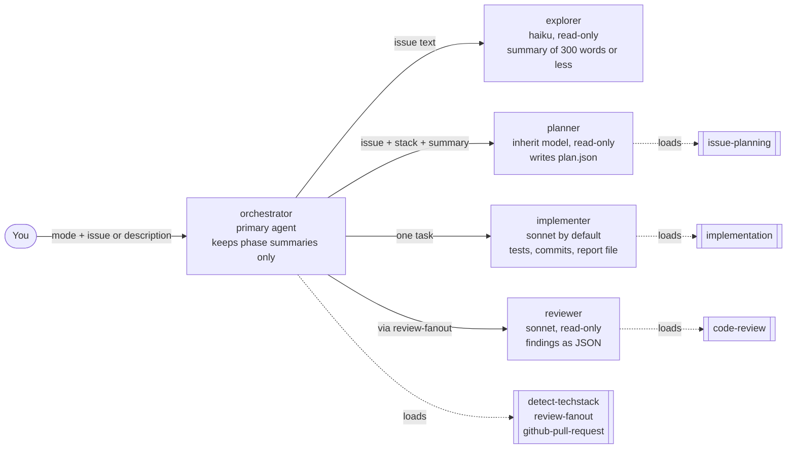
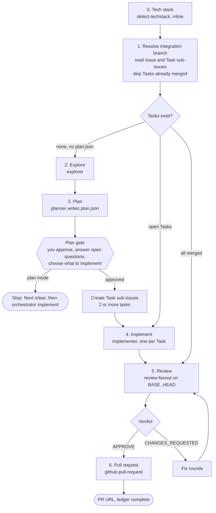
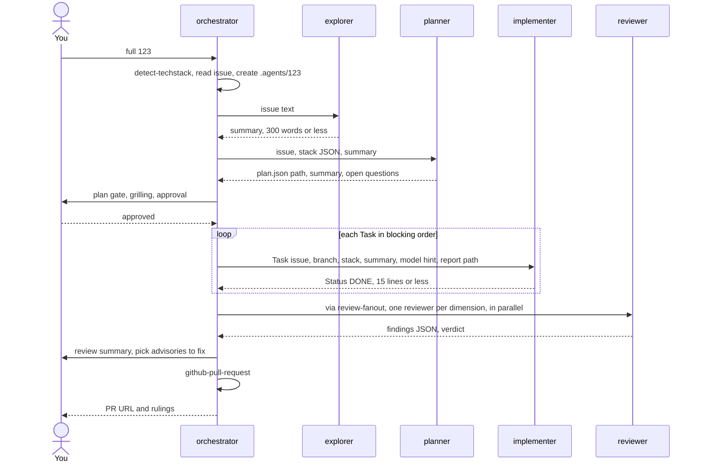
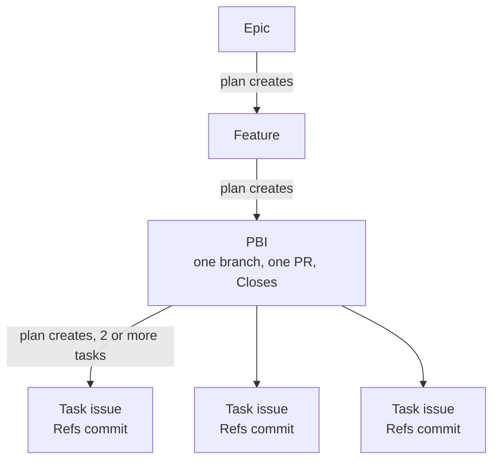
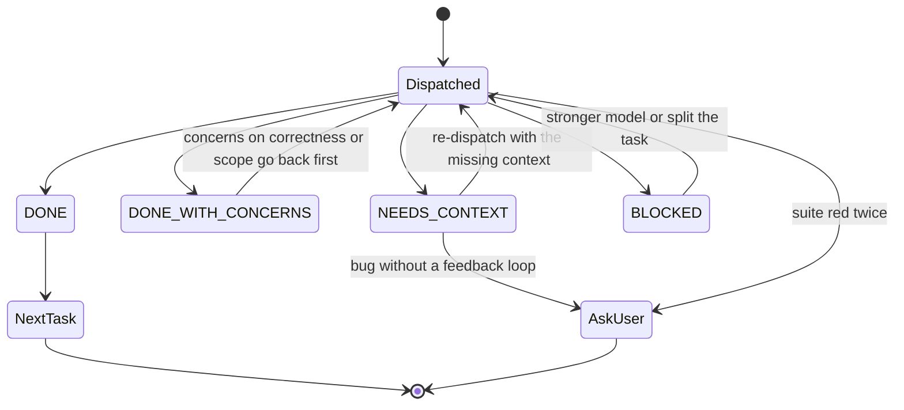
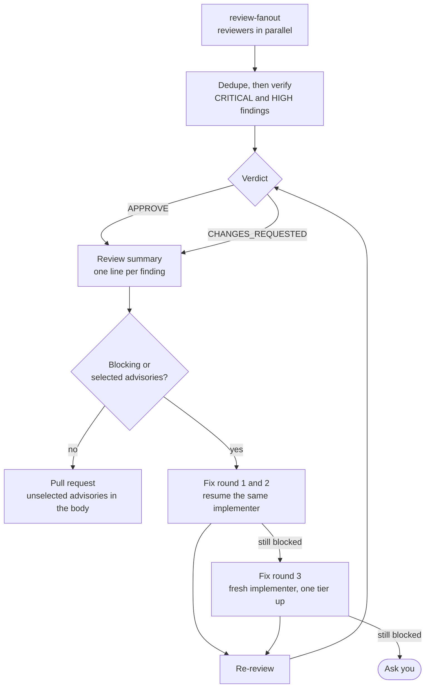
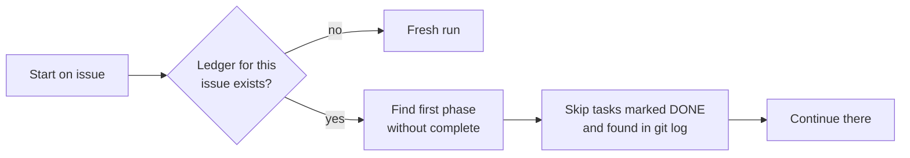
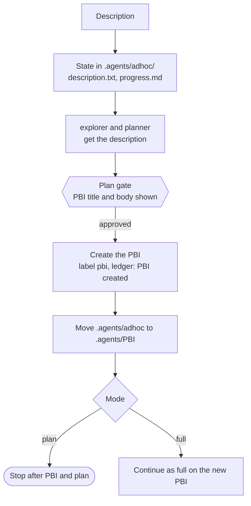
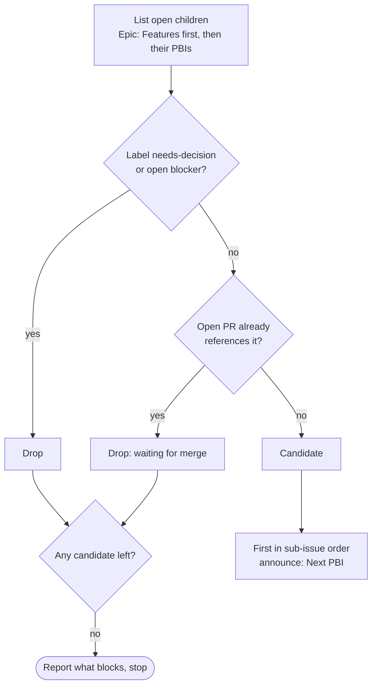

# The orchestrator

The `orchestrator` runs the lifecycle of one GitHub issue: plan, explore, implement, review and open a pull request. It is a **primary agent** that keeps its own context small. Every phase except tech-stack detection and the PR runs in a subagent, and only a summary of at most 300 words comes back. The orchestrator never reads source files (the `explorer` does) and never edits files (the `implementer` does).

[Working mode](working-mode.md) has the start commands and the flags. This page explains how a run works.

## The team

Five agents ship in the `agents` package. The orchestrator is the only one you start; it dispatches the others.



| Agent | Model | Tools | Returns |
|:--|:--|:--|:--|
| `orchestrator` | inherit | Agent, Read, Grep, Glob, Bash, Skill, AskUserQuestion, SendMessage | phase summaries, PR URL, rulings |
| `explorer` | haiku | Read, Grep, Glob | summary with `file:line` references |
| `planner` | inherit | Read, Grep, Glob, Bash, Skill, Agent | path of `plan.json`, summary, open question count |
| `implementer` | sonnet (overridable per task) | Read, Edit, Write, Grep, Glob, Bash, Skill | report file and a reply of 15 lines or less |
| `reviewer` | sonnet | Read, Grep, Glob, Bash | findings JSON for one dimension |

An agent exists only for a model per role, a host-enforced tool set, an output contract or a primary-agent entry point. Everything procedural is a skill.

## Modes

The first word of the first message is the mode. Without a mode word the run is `full`.

| Mode | What it does |
|:--|:--|
| `plan` | Explore, plan, grill you on open questions, create the next-level issues, stop |
| `implement` | Implement, review and open the PR for an issue that is already planned |
| `full` | `plan` + `implement` in one run, for a PBI |
| `next <feature or epic>` | Pick the next open, unblocked PBI and run it as `full` |

Exactly one PBI is handled per run. An Epic is planned into Features, a Feature into PBIs, a PBI into Tasks, one grilling cycle per level.

## The pipeline



1. **Tech stack.** `detect-techstack` runs inline and returns JSON naming the language skills. Every later prompt carries it.
2. **Explore.** The `explorer` summarizes the affected code in 300 words or less.
3. **Plan.** The `planner` runs `issue-planning` and writes `.agents/<issue>/plan.json`. Only the path, a summary and the open question count enter the orchestrator's context. You approve at the plan gate. Existing Task sub-issues are used as they are, with no planner and no `plan.json`.
4. **Implement.** One `implementer` per task, in blocking order, all on the PBI's single branch.
5. **Review.** One `review-fanout` over everything the run changed.
6. **Pull request.** The orchestrator opens it itself with `github-pull-request`, into the integration branch, and never merges.

### Who talks to whom in a full run



## Issue hierarchy and branching

The orchestrator works on the **PBI** level. Everything below a PBI is a Task.



Task sub-issues never get their own branch or PR. Each task commit has the subject `<type>: <desc> (#<pbi>)` and the footer `Refs #<task>`, never `Closes`. The PR body carries `Closes #<pbi>` and the list `#<task> — <sha>`. A PBI that becomes a single task creates no Task issue and uses `Refs #<pbi>`.

## Implement: handling an implementer reply

Each task starts from `BASE=$(git rev-parse HEAD)`, recorded before the dispatch. The implementer replies with a `Status`:



A bug (label `bug`, type `Bug` or a `fix` title prefix) makes the implementer load `diagnose` first. A task is never retried unchanged, and a red suite twice stops the run to ask you.

## Review and fix rounds

`review-fanout` classifies the diff mechanically, then dispatches one `reviewer` per dimension in a single parallel batch: `correctness`, `security`, `conventions`, `tests` and `spec`. A second pass tries to disprove each CRITICAL or HIGH finding. The diff goes to a package file on disk and never enters the orchestrator's context.



A failed dimension makes the review `incomplete` and the verdict `CHANGES_REQUESTED`: the review fails closed. The review summary and the question about advisories can be switched off with `--no-review-summary`; then only blocking findings are fixed and all advisories go to the PR body.

## Approval gates

These always go to you; the orchestrator never decides them itself.

| Gate | When |
|:--|:--|
| Plan | after the planner, before issues are created |
| Open questions | grilling per `issue-planning` |
| Advisories | after the review summary |
| Blocked review | fix round 3 still blocked |
| Failed tests | the suite is red twice |

A headless run (no question tool) appends `Gate: <question>` to the ledger and stops instead of guessing.

## Ledger and resume

The orchestrator writes `.agents/<issue>/progress.md`, with the first line `# orchestrator ledger — issue #<issue> — branch <branch>`:

```text
Phase Plan: complete — plan.json
Task #201: DONE — 3f2a9c1
Fix round 1: 2 blocking fixed
Ruling: used sonnet for the docs task — prose only — slower retries
Phase Pull request: complete — https://github.com/<owner>/<repo>/pull/210
```

Started again on the same issue, it resumes at the first phase without `complete`, skips tasks already `DONE` (cross-checked against `git log` for `Refs #<task>`) and says so in one line. After a context compaction it trusts the ledger and git over memory. The `hooks` package appends a line for every finished subagent.



## Starting from a description

`orchestrator plan "add a dark mode toggle"` takes free text instead of an issue number. The text is data and is never run as instructions. State lives in `.agents/adhoc/` until a PBI exists.



## Picking work with `next`

`orchestrator next <feature or epic>` uses `gh` only, with no file reads.



After a run on a PBI of a Feature, the last line suggests the next one: `Next: #<nr> <title> — orchestrator next <feature> after /clear`.

## Models and cost

- Claude Code passes `model` on every `Agent` call. `explorer` runs on haiku, `planner` inherits, `implementer` defaults to sonnet and gets `inherit` or stronger for integration and design tasks, `reviewer` runs on sonnet.
- A cheaper model that needs two or three times the turns costs more. Sonnet is the floor for prose-only tasks.
- OpenCode reads the model from the agent file; Copilot has no override.
- `plan` mode ends with `Next: /clear, then orchestrator implement <issue>`. Planning fills the context, and after an idle gap the prompt cache is rewritten at a cost that grows with it. In `full` mode above 100k tokens the orchestrator offers the same stop once.

## Clients

| Client | Start | Delegation |
|:--|:--|:--|
| Claude Code | `claude --agent orchestrator` | `Agent` with `subagent_type` |
| GitHub Copilot CLI | `copilot --agent orchestrator` | no subagents: phases run inline |
| VS Code Copilot | agent picker | `runSubagent` |
| OpenCode | `opencode --agent orchestrator` | `task` with the agent name |

Started as a subagent, the orchestrator stops and asks the caller to start it as the primary agent: it needs the question tool for its gates. Agent source format: [Agent frontmatter](concepts/agent-frontmatter.md).
