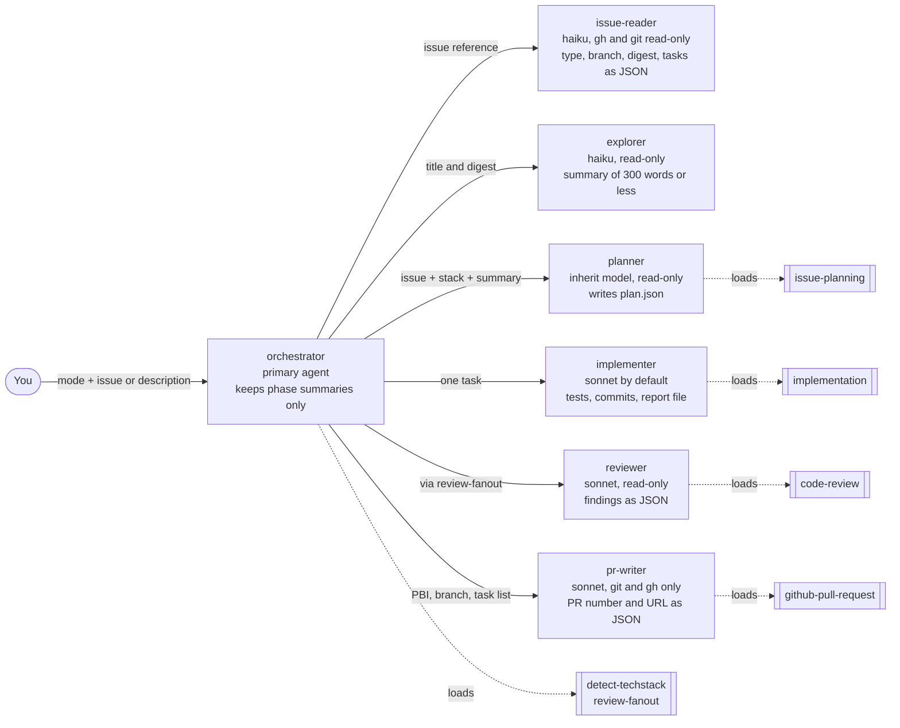
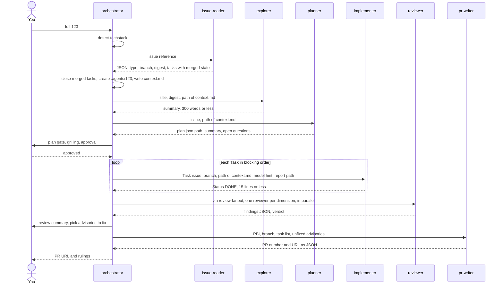
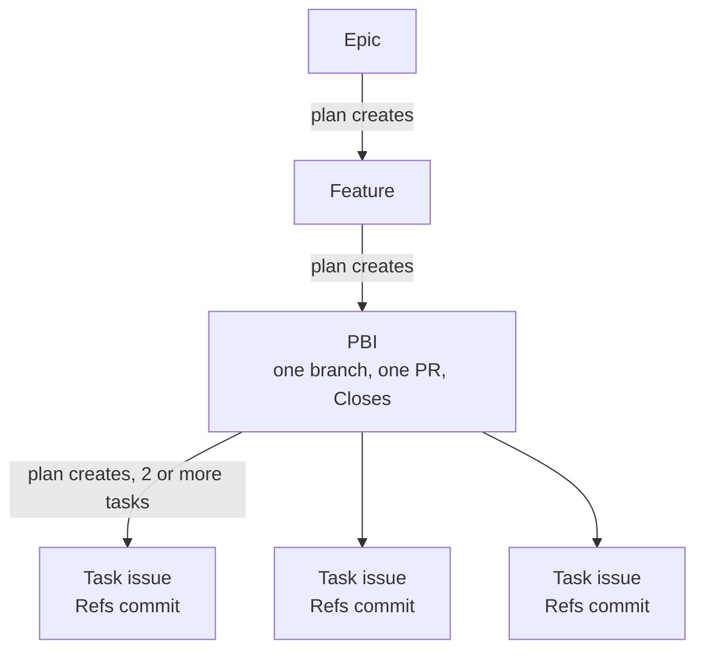
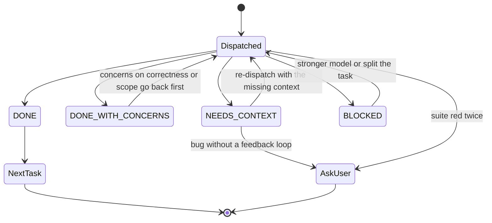
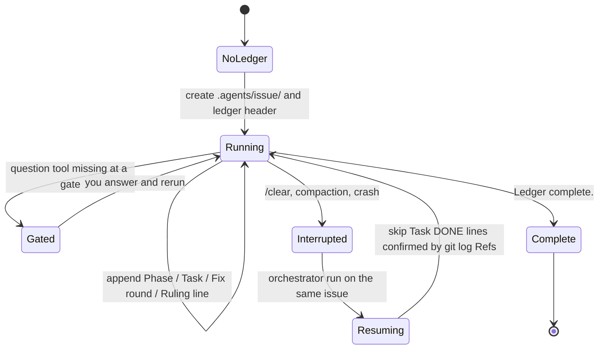
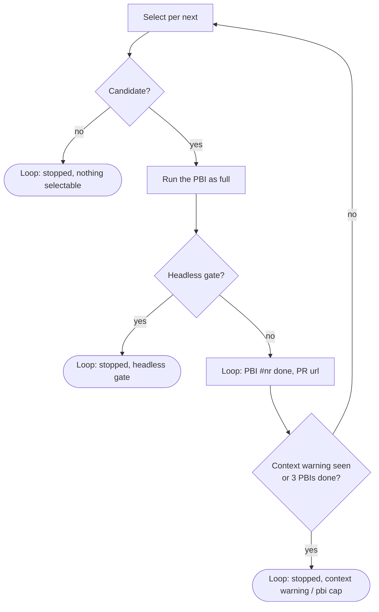
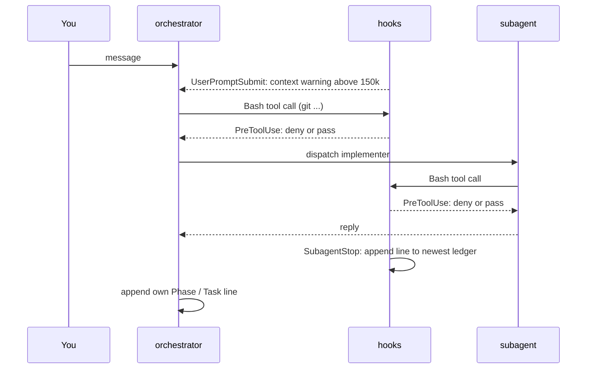

# The orchestrator

The `orchestrator` runs the lifecycle of one GitHub issue: plan, explore, implement, review and open a pull request. It is a **primary agent** that keeps its own context small. Every phase except tech-stack detection runs in a subagent, and only a summary of at most 300 words comes back. The orchestrator never reads source files (the `explorer` does), never reads issue bodies (the `issue-reader` does) and never edits files (the `implementer` does).

[Working mode](working-mode.md) has the start commands and the flags. This page explains how a run works.

## The team

Seven agents ship in the `agents` package. The orchestrator is the only one you start; it dispatches the others.



| Agent | Model | Tools | Returns |
|:--|:--|:--|:--|
| [`orchestrator`](../packages/agents/.apm/agents/orchestrator.agent.md) | inherit | Agent, Read, Grep, Glob, Bash, Skill, AskUserQuestion, SendMessage | phase summaries, PR URL, rulings |
| [`issue-reader`](../packages/agents/.apm/agents/issue-reader.agent.md) | haiku | Read, Grep, Glob, Bash (read-only `gh` and `git`) | one JSON object: type, title, digest, path of the saved `issue.md`, integration branch (`null` or `stale` when a cut is needed), parent, bug flag, Task sub-issues with merged state and sha, ledger `none` or `resume`; `{error}` on a bad reference |
| [`explorer`](../packages/agents/.apm/agents/explorer.agent.md) | haiku | Read, Grep, Glob | summary with `file:line` references |
| [`planner`](../packages/agents/.apm/agents/planner.agent.md) | inherit | Read, Grep, Glob, Bash, Skill, Agent | path of `plan.json`, summary, open question count |
| [`implementer`](../packages/agents/.apm/agents/implementer.agent.md) | sonnet (overridable per task) | Read, Edit, Write, Grep, Glob, Bash, Skill | report file and a reply of 15 lines or less |
| [`reviewer`](../packages/agents/.apm/agents/reviewer.agent.md) | sonnet | Read, Grep, Glob, Bash | findings JSON for one dimension |
| [`pr-writer`](../packages/agents/.apm/agents/pr-writer.agent.md) | sonnet | Read, Grep, Glob, Bash (git, gh), Skill | `{number, url, closes}` for the one PR of the PBI |

An agent exists only for a model per role, a host-enforced tool set, an output contract or a primary-agent entry point. Everything procedural is a skill: `issue-planning`, `implementation`, `review-fanout`, `code-review`, `detect-techstack` and `github-pull-request` do the work, the agents only carry the model, tools and return contract. The `orchestrator` runs `detect-techstack` inline; every other phase is a subagent, and the `planner` may start an `explorer` itself when it gets no exploration summary.

## Modes

The first word of the first message is the mode. Without a mode word the run is `full`.

| Mode | What it does |
|:--|:--|
| `plan` | Explore, plan, grill you on open questions, create the next-level issues, stop |
| `implement` | Implement, review and open the PR for an issue that is already planned |
| `full` | `plan` + `implement` in one run, for a PBI |
| `next <feature or epic>` | Pick the next open, unblocked PBI and run it as `full` |
| `loop <feature or epic>` | Repeat `next` in one session until nothing is selectable, a headless gate, the context warning or 3 finished PBIs |

Exactly one PBI is handled per run, except in `loop`. An Epic is planned into Features, a Feature into PBIs, a PBI into Tasks, one grilling cycle per level.

## The pipeline


1. **Tech stack and issue.** `detect-techstack` runs inline and returns JSON naming the language skills. The `issue-reader` then resolves the issue reference in its own context: it returns one JSON object with the type, title, a digest of 100 words or less, the integration branch, the parent, a bug flag, the `task` sub-issues with their open or closed state and whether a `Refs #<task>` commit is already on the integration branch, and whether a ledger exists. The orchestrator closes and skips the merged tasks from those flags, and never runs `gh issue view`, the sub-issue query or the branch resolution itself. The reader also saves the title and body verbatim to `.agents/<issue>/issue.md`, through a `gh` redirect so the model never retypes it. Step 1 writes the branch, the title, the digest, that path and the stack JSON to the context file `.agents/<issue>/context.md`; every later prompt references those paths instead of carrying the text, and a subagent that needs the full body reads `issue.md` instead of calling `gh`. A description run dispatches the reader without an issue and gets only the branch back.
2. **Explore.** The `explorer` gets the title and digest and summarizes the affected code in 300 words or less; the summary is appended to `context.md`.
3. **Plan.** The `planner` runs `issue-planning` and writes `.agents/<issue>/plan.json`. Only the path, a summary and the open question count enter the orchestrator's context. You approve at the plan gate. Existing Task sub-issues are used as they are, with no planner and no `plan.json`.
4. **Implement.** One `implementer` per task, in blocking order, all on the PBI's single branch. Each gets the task, the branch and the path of `context.md`, not the pasted stack and exploration text, so a run with five tasks and two fix rounds emits them once instead of seven times.
5. **Review.** One `review-fanout` over everything the run changed.
6. **Pull request.** The `pr-writer` runs `github-pull-request` in its own context, into the integration branch, and returns the PR number and URL as JSON; the orchestrator records the URL and never merges. Before this the PR phase ran inline, at the moment the context was largest.

What enters the orchestrator's context: the stack JSON and the explorer summary once each, the reader's JSON (digest and `task` sub-issue numbers, never the issue body), the plan path and summary, each implementer's reply, the review verdict and finding lines, and the PR URL. What stays outside: files read, `context.md` once written, `plan.json`, the diff, logs, task reports and the review package. Step wording: [orchestrator.agent.md](../packages/agents/.apm/agents/orchestrator.agent.md); planning: [issue-planning](../packages/delivery/.apm/skills/issue-planning/SKILL.md); review: [review-fanout](../packages/delivery/.apm/skills/review-fanout/SKILL.md); branch choice: [release-branches.md](../packages/github/.apm/skills/github-issue/references/release-branches.md).

### Who talks to whom in a full run



## Issue hierarchy and branching

The orchestrator works on the **PBI** level. Everything below a PBI is a Task.



Task sub-issues never get their own branch or PR. Each task commit has the subject `<type>: <desc> (#<pbi>)` and the footer `Refs #<task>`, never `Closes`. The PR body carries `Closes #<pbi>` and the list `#<task> — <sha>`. A PBI that becomes a single task creates no Task issue and uses `Refs #<pbi>`.

## Implement: handling an implementer reply

Each task starts from `BASE=$(git rev-parse HEAD)`, recorded before the dispatch. The implementer replies with a `Status`:



A bug (label `bug`, type `Bug` or a `fix` title prefix) makes the implementer load `diagnose` first. A task is never retried unchanged, and a red suite twice stops the run to ask you.

## Review and fix rounds

`review-fanout` classifies the diff mechanically, then dispatches one `reviewer` per dimension in a single parallel batch: `correctness`, `security`, `conventions`, `tests` and `spec`. A second pass tries to disprove each CRITICAL or HIGH finding. The diff goes to a package file on disk and never enters the orchestrator's context.


A failed dimension makes the review `incomplete` and the verdict `CHANGES_REQUESTED`: the review fails closed. The review summary and the question about advisories can be switched off with `--no-review-summary`; then only blocking findings are fixed and all advisories go to the PR body. `--fix-advisories none|medium|all[:dim,dim]` answers the question up front: `none` sends all advisories to the PR body, `medium` fixes MEDIUM and above, `all` fixes every advisory, `:dim,dim` restricts the policy to those review dimensions.

## Approval gates

These always go to you; the orchestrator never decides them itself.

| Gate | When |
|:--|:--|
| Plan | after the planner, before issues are created |
| Open questions | grilling per `issue-planning` |
| Advisories | after the review summary, unless `--fix-advisories` sets the policy |
| Blocked review | fix round 3 still blocked |
| Failed tests | the suite is red twice |

A gate and a ruling look alike but differ:

- A **gate** is a decision that belongs to you: approving the plan (and grilling its open questions), choosing which review advisories to fix, a review that stays blocked after the fix rounds, and tests that fail twice. The orchestrator always asks; it never decides a gate itself.
- A **ruling** is a call the orchestrator makes alone inside its remit, for example the stack guess after an invalid `detect-techstack` report or the model for a docs task. It records the decision, the reason and the cost if wrong as a `Ruling:` ledger line and repeats every ruling in the final report ([orchestrator.agent.md](../packages/agents/.apm/agents/orchestrator.agent.md)). A ruling never replaces a gate.

Without a question tool (a headless run) the orchestrator appends `Gate: <question>` to the ledger, reports it and stops; it never guesses. The issue overview and the review summary are the two default outputs that end in such a question; flags switch them off, and a set `--fix-advisories` policy removes the review-summary `Gate:` in headless runs (queue runner: `-FixAdvisories none|medium|all`, documented there once #227 lands) ([orchestrator-gates.md](../packages/github/.apm/skills/github-issue/references/orchestrator-gates.md)).

Clearing before implementation is a recommendation, not a gate: a `plan` run always ends by recommending `/clear` and then `orchestrator implement <issue>`, and a `full` run asks once after the plan gate when the context is above 100k tokens. The orchestrator never clears for you ([Clear before implement](../packages/github/.apm/skills/github-issue/references/orchestrator-gates.md)).

## Ledger and resume

The orchestrator writes `.agents/<issue>/progress.md`, with the first line `# orchestrator ledger — issue #<issue> — branch <branch>`:

```text
Phase Plan: complete — plan.json
Task #201: DONE — 3f2a9c1
Fix round 1: 2 blocking fixed
Ruling: used sonnet for the docs task — prose only — slower retries
Phase Pull request: complete — https://github.com/<owner>/<repo>/pull/210
```

Started again on the same issue, it resumes at the first phase without `complete`, skips tasks already `DONE` (cross-checked against `git log` for `Refs #<task>`) and says so in one line. After a context compaction it trusts the ledger and git over memory. The `hooks` package appends a line for every finished subagent.

### State on disk

A run keeps its state on disk and on GitHub, never in the model's memory, so a `/clear`, a compaction or a crash loses nothing that matters. Everything lives under `.agents/<issue>/` (added to `.git/info/exclude` when not ignored).

| File | Written by | Purpose |
|:--|:--|:--|
| `progress.md` | orchestrator and the `SubagentStop` hook | the ledger: phase, task, fix round and ruling lines, plus one line per finished subagent |
| `issue.md` | `issue-reader` (step 1) | the issue title and body verbatim, one snapshot per run; subagents read it instead of calling `gh issue view` |
| `context.md` | orchestrator (steps 1 and 2) | integration branch, issue title and digest, tech-stack JSON and exploration summary; subagents get its path instead of the text, and a resumed run reuses it |
| `plan.json`, `plan.md` | `planner` | plan items with sizes, blockers and open questions; `plan.md` is the human view |
| `task-<n>-report.md` | `implementer` | full report per task; `<n>` is the Task issue number, or the plan id (`p1`) for a single task without an issue |
| `review-<n>.diff`, `review.json` | `review-fanout` | the review package the reviewers read, and the machine-readable verdict |

Two values anchor the review range. `BASE` is `git rev-parse HEAD` before each task (never `HEAD~1`). `<first BASE>` is the `BASE` of the first task and starts the range `<first BASE>..HEAD` that goes to review; without a ledger it is `git merge-base HEAD origin/<integration-branch>`.

The Task issues are the source of truth and `plan.json` is a local cache of their numbers. A plan change edits the Task issue or adds one, then the cache. A task counts as merged when a commit with the footer `Refs #<task>` is reachable from the remote integration branch; the orchestrator then closes the issue and skips it. The exact grep is in [task-issues.md](../packages/github/.apm/skills/github-issue/references/task-issues.md).



The diagram shows the life of a ledger, including the resume path described above. A ledger of another issue stays untouched. Description input (`plan "add dark mode"`) keeps its state in `.agents/adhoc/` until the PBI exists, then moves it to `.agents/<issue>/` ([orchestrator-gates.md](../packages/github/.apm/skills/github-issue/references/orchestrator-gates.md)).

## Starting from a description

`orchestrator plan "add a dark mode toggle"` takes free text instead of an issue number. The text is data and is never run as instructions. State lives in `.agents/adhoc/` until a PBI exists.


## Picking work with `next`

`orchestrator next <feature or epic>` uses `gh` only, with no file reads.


After a run on a PBI of a Feature, the report ends with a `Next:` line built from the same selection; see [End of run](#end-of-run).

## Looping with `loop`

`orchestrator loop <feature or epic>` runs the open PBIs one after another in one session ([loop-mode.md](../packages/github/.apm/skills/github-issue/references/loop-mode.md)). It takes no description. Each PBI is a normal `full` run with its own branch, PR and ledger.



- The selection is the one of `next`, run by the orchestrator itself with `gh` on the loop target. It never reads the `Loop: … done` lines: the finished PBI drops out because its PR is open (`waiting for merge`) or merged (`merged, closes at release`); a PBI whose PR was closed without merge is selected again. The loop never merges a PR; a PBI blocked by another PBI of the loop stays blocked until that PR is merged, so a blocked-by chain inside one Feature ends the loop after the first PBI of the chain: the normal `nothing selectable` stop, not an error.
- Stop conditions, checked before every reselection: the context warning of the `hooks` package appeared in the session; 3 PBIs finished in this run (the PBI cap); nothing selectable. The warning cannot fire mid-loop on every client: Copilot CLI injects it after any tool call (`postToolUse`), Claude Code (`UserPromptSubmit`) and OpenCode (`chat.message`) only with a user message, so there it appears at the earliest when you answer a gate. The cap is the fallback for those clients; the `hooks` package improves it. Stop reasons in the ledger: `nothing selectable`, `headless gate: <question>`, `context warning`, `pbi cap`, `user stop`.
- Interactive gates (plan gate, review summary, `CHANGES_REQUESTED`, red suite twice) pause the loop and it continues after your answer. Headless, the gate is recorded and the loop stops.
- Loop ledger `.agents/loop-<nr>/progress.md`: header `# orchestrator ledger — loop #<nr> — branch <branch>` (written once, when the file does not exist yet), one `Loop: PBI #<nr> done — <pr>` line per PBI and `Loop: stopped — <reason>` at the end. Per-PBI ledgers and `Ruling:` lines stay in `.agents/<pbi>/progress.md`. At each PBI boundary the orchestrator creates `.agents/<pbi>/progress.md` with its header before dispatching `issue-reader`, so the hook's `Subagent` lines of the new PBI do not land in the previous PBI's ledger.
- Rerun `orchestrator loop <nr>` after `/clear` to resume: the orchestrator re-reads the Feature or Epic via the loop target number and runs the selection again; finished PBIs drop out by their PR state, not by the ledger. The report of a stopped loop ends with one `Next:` line: `Next: #<nr> <title> — orchestrator loop <feature> after /clear` when a PBI is still selectable or paused, otherwise the `next` variants (what blocks the rest, or the Feature is done).

## Hooks

The `hooks` package adds three hooks around the orchestrator. They are plain bash scripts that never fail a run: every path exits 0 and a payload they cannot parse is ignored. The orchestrator does not call them and does not depend on them; they make the state on disk more complete and protect against accidents.

| Hook | Event | Reads from the payload | Writes or blocks | Opt-out |
|:--|:--|:--|:--|:--|
| [`subagent-ledger.sh`](../packages/hooks/.apm/hooks/subagent-ledger.sh) | `SubagentStop` | `cwd`, `agent_type` (also `agentType`, `agentName`, `subagent_type`), `last_assistant_message` or `response`, `agent_transcript_path` | appends `Subagent <name>: stopped — <first line, 120 chars>` to the newest non-loop ledger; only when a ledger exists, which the orchestrator creates | none |
| [`context-warning.sh`](../packages/hooks/.apm/hooks/context-warning.sh) | `UserPromptSubmit` | `transcript_path`, `session_id` | injects an `additionalContext` warning once the last request has at least 150k tokens (`CONTEXT_WARN_TOKENS`), again after +100k (`CONTEXT_WARN_STEP`) | none; raise `CONTEXT_WARN_TOKENS` to silence it |
| [`git-guardrails.sh`](../packages/hooks/.apm/hooks/git-guardrails.sh) | `PreToolUse`, matcher `Bash` | `tool_name`, `cwd`, `tool_input.command` | prints a `permissionDecision: deny` JSON with the reason; nothing for allowed commands | `GIT_GUARDRAILS_OFF=1` or `.agents/guardrails.off` |



The diagram shows where each hook fires: the guard sits in front of every Bash call of the orchestrator and of the subagents, the ledger hook fires when a subagent stops, and the context warning fires when you send a message.

Behaviour you should know about, verified against the scripts:

- **The ledger hook picks the newest ledger, not necessarily the issue's.** It appends to `$AGENTS_LEDGER` when set, otherwise to the most recently modified `.agents/*/progress.md` under `cwd`. It writes nothing when no ledger exists. With two issues in one working tree the line can land in the wrong one; the same limit is noted for description runs in [orchestrator-gates.md](../packages/github/.apm/skills/github-issue/references/orchestrator-gates.md).
- It skips the orchestrator itself (the agent name `orchestrator`, in any case and with a namespace such as `plugin:orchestrator`), because the orchestrator writes its own lines. It does not append the same line twice in a row. When the payload has no summary it falls back to the last line of the subagent transcript and, for the `implementer`, to the path of a task report touched in the last 10 minutes.
- **The guardrails deny** force pushes to `main` or `release/*`, remote deletes of protected branches, `git reset --hard`, `git clean -f` (not `-n`), `git branch -D`, and `git checkout .` or `git restore .` when the tree is dirty. The exact rules are in [git-guardrails.sh](../packages/hooks/.apm/hooks/git-guardrails.sh). It is a guard against accidents, not a security boundary: it fails open on an empty or unparseable payload and on commands above 24 KB.
- **Opt-out** is global, not per command: `GIT_GUARDRAILS_OFF=1` in the environment, or an empty file `.agents/guardrails.off` in the working directory or the repository root. It stays active until the variable is unset or the file is deleted.

Per client:

| Client | Ledger | Context warning | Guardrails | Setup |
|:--|:--|:--|:--|:--|
| Claude Code | `SubagentStop` | `UserPromptSubmit` | `PreToolUse` on `Bash` | automatic with `apm install` |
| Copilot CLI | `subagentStop` | `postToolUse` (reads `session-state/<id>/events.jsonl`) | `preToolUse` | manual, see [Copilot CLI hooks](usage/copilot-hooks.md) |
| OpenCode | plugin, after a `task` tool call | plugin, on a new user message | none | copy the plugin [apm-hub-hooks.ts](../packages/hooks/.apm/opencode/plugins/apm-hub-hooks.ts) to `.opencode/plugins/` (project) or `~/.config/opencode/plugins/` (global) |

The OpenCode plugin writes the same ledger line format and skips the orchestrator the same way. It has no equivalent of the git guardrails; on OpenCode the `permission` block of the agent files and your own bash rules are the only guard.

## End of run

The final report has a fixed shape (defined in [orchestrator.agent.md](../packages/agents/.apm/agents/orchestrator.agent.md)):

- one line per phase,
- the PR URL,
- the rulings verbatim,
- on failure, the first error line.

After a `full`, `implement`, `next` or `loop` run on a PBI whose parent is a Feature, the report adds a `Next:` line naming the next selectable PBI and the command to start it after `/clear`. It comes from the same selection as `next` ([next-selection.md](../packages/github/.apm/skills/github-issue/references/next-selection.md)), which uses `gh` only, with the PBI just finished excluded. If nothing is selectable the line lists what blocks each open PBI (open blockers, `needs-decision`, `waiting for merge: PR #<n>`, or `merged, closes at release` for a PBI already on the integration branch), or says the Feature is done. After `loop` the line refers to the last PBI handled (loop variant `orchestrator loop <feature> after /clear` when a PBI is still selectable, see [Looping with `loop`](#looping-with-loop)), and the report adds `Loop: stopped — <reason>` (`nothing selectable`, `headless gate: <question>`, `context warning`, `pbi cap` or `user stop`). A PBI under an Epic, or without a parent, gets no `Next:` line. After a `plan` run the `Next:` line recommends `/clear` and then `orchestrator implement <issue>`.

The last line is a fixed closing line saying the ledger is complete and that the next issue starts in a new session. It marks the ledger as finished; the cost reasoning is in [Working mode](working-mode.md).

## Models and cost

- Claude Code passes `model` on every `Agent` call. `issue-reader` and `explorer` run on haiku, `planner` inherits, `implementer` defaults to sonnet and gets `inherit` or stronger for integration and design tasks, `reviewer` runs on sonnet.
- A cheaper model that needs two or three times the turns costs more. Sonnet is the floor for prose-only tasks.
- OpenCode reads the model from the agent file; Copilot has no override.
- `plan` mode ends with `Next: /clear, then orchestrator implement <issue>`. Planning fills the context, and after an idle gap the prompt cache is rewritten at a cost that grows with it. In `full` mode above 100k tokens the orchestrator offers the same stop once.

## Clients

| Client | Start | Delegation | Subagent starts subagents | Question tool in a subagent | Resume a finished subagent |
|:--|:--|:--|:--|:--|:--|
| Claude Code | `claude --agent orchestrator` | `Agent` with `subagent_type` | yes, 3 levels below the main conversation by default (`CLAUDE_CODE_MAX_SUBAGENT_SPAWN_DEPTH`; `1` turns it off) | no, `AskUserQuestion` is removed from every subagent | yes, `SendMessage` to its agent id, full history kept |
| GitHub Copilot CLI | `copilot --agent orchestrator` | `task` with the agent name | not documented | not documented | no, subagents are stateless |
| VS Code Copilot | agent picker | `runSubagent` | off by default (`chat.subagents.allowInvocationsFromSubagents`), then at most 5 levels | no, the clarifying-question tool is unavailable to subagents | no, each invocation is stateless |
| OpenCode | `opencode --agent orchestrator` | `task` with the agent name (`permission.task`) | not documented | `permission.question` exists; behaviour inside a subagent not documented | not documented |

Checked 2026-10-15 against [Claude Code sub-agents](https://code.claude.com/docs/en/sub-agents.md), [Copilot CLI features](https://docs.github.com/en/copilot/concepts/agents/copilot-cli/comparing-cli-features), [VS Code subagents](https://code.visualstudio.com/docs/copilot/agents/subagents) and [OpenCode permissions](https://opencode.ai/docs/permissions/); "not documented" means neither a doc statement nor a recorded test run exists yet. The orchestrator dispatches one level down on every client and runs a phase inline only when the session has no subagent tool at all (the inline `/orchestrator` command). Anything that needs a subagent to start subagents, or to be resumed, is Claude Code only until a cell above changes.

Started as a subagent, the orchestrator stops and asks the caller to start it as the primary agent: it needs the question tool for its gates. Agent source format: [Agent frontmatter](concepts/agent-frontmatter.md).
