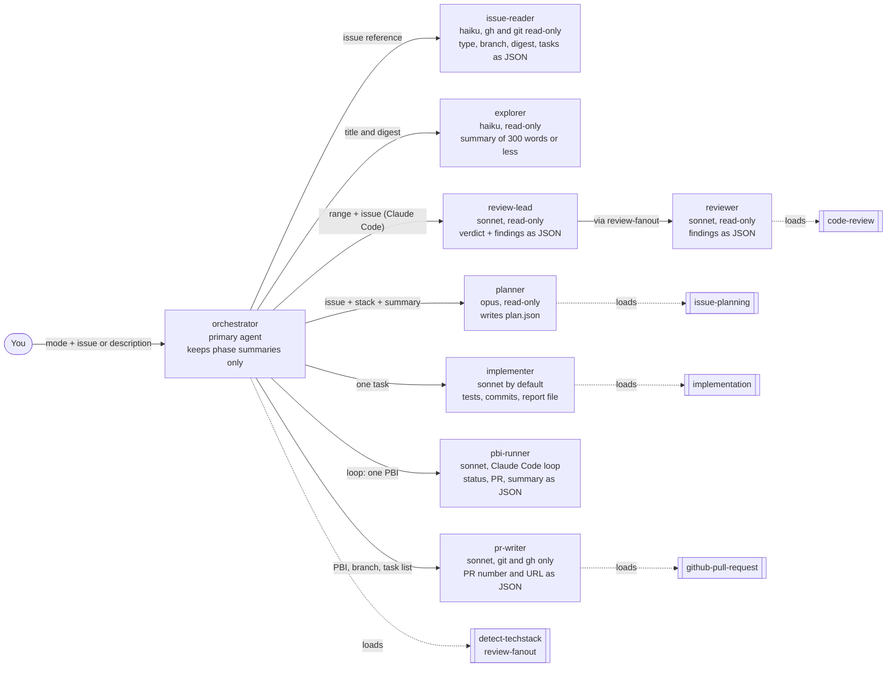
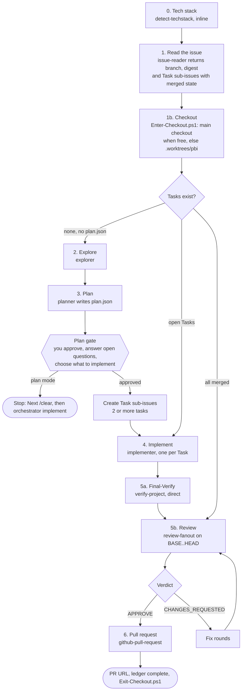
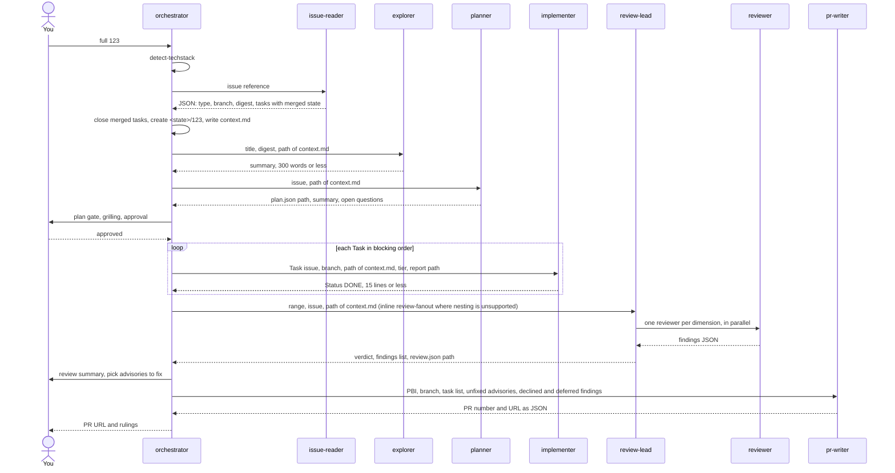
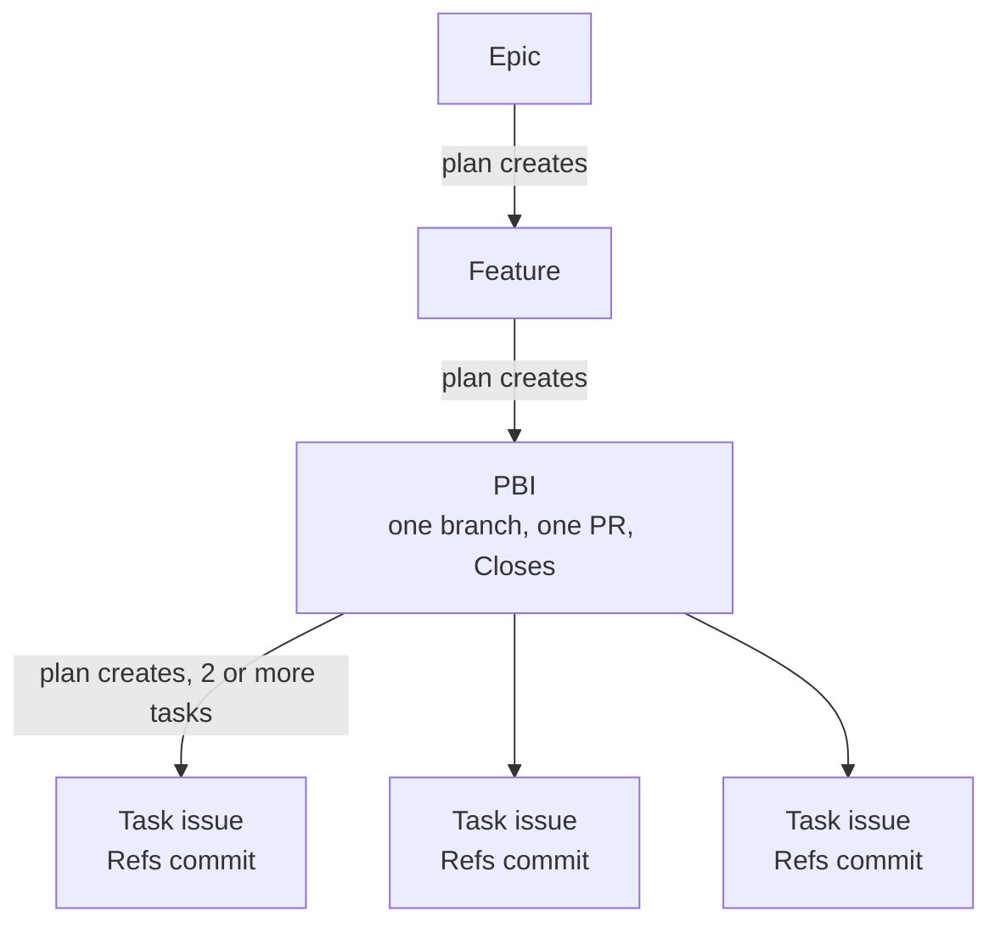
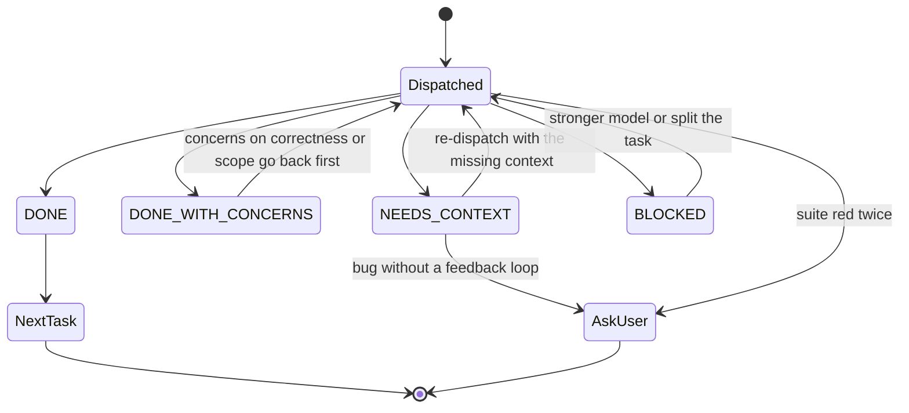
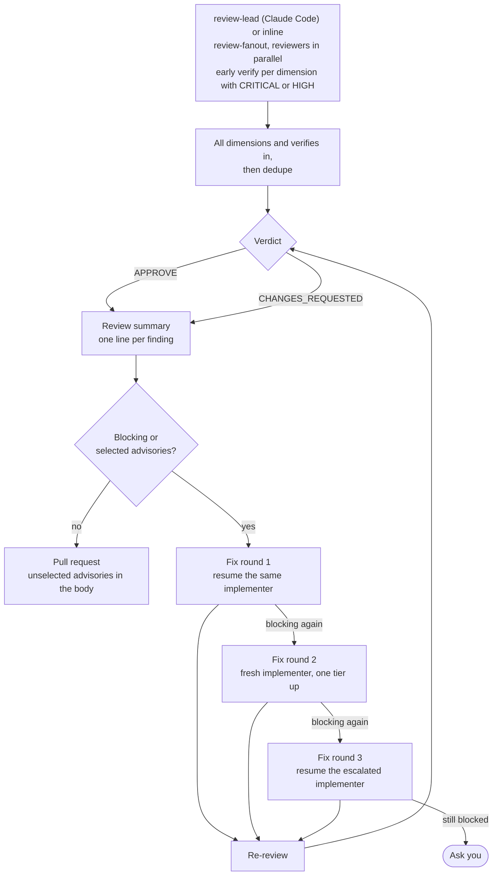
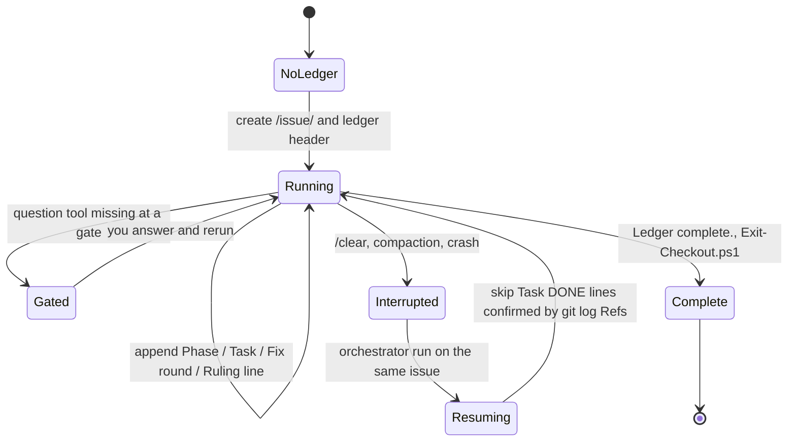
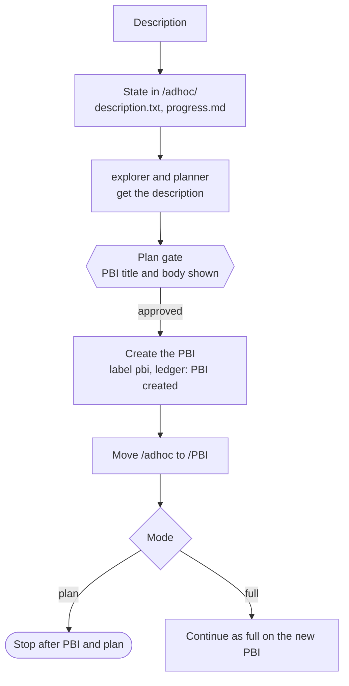
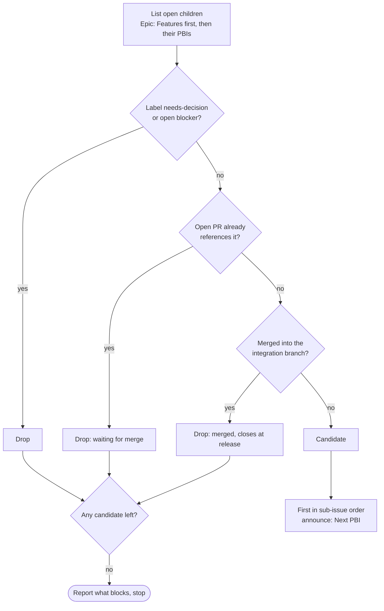
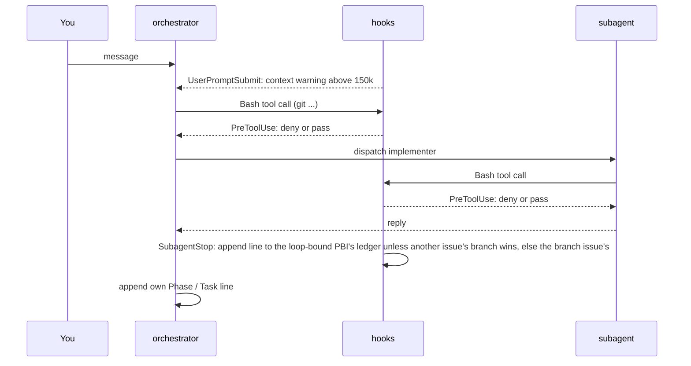

# The orchestrator

The `orchestrator` runs the lifecycle of one GitHub issue: plan, explore, implement, review and open a pull request. It is a **primary agent** that keeps its own context small. Every phase except tech-stack detection runs in a subagent, and only a summary of at most 300 words comes back. The orchestrator never reads source files (the `explorer` does), never reads issue bodies (the `issue-reader` does) and never edits files (the `implementer` does).

[Working mode](working-mode.md) has the start commands and the flags. This page explains how a run works.

## The team

Nine agents ship in the `agents` package. The orchestrator is the only one you start; it dispatches the others.



| Agent | Model | Tools | Returns |
|:--|:--|:--|:--|
| [`orchestrator`](../packages/agents/.apm/agents/orchestrator.agent.md) | sonnet (override: [Models and cost](#models-and-cost)) | Agent, Read, Grep, Glob, Bash, Skill, AskUserQuestion, SendMessage | phase summaries, PR URL, rulings |
| [`issue-reader`](../packages/agents/.apm/agents/issue-reader.agent.md) | haiku | Read, Grep, Glob, Bash (read-only `gh` and `git`) | one JSON object: type, title, digest, path of the saved `issue.md`, integration branch (`null` or `stale` when a cut is needed), parent, bug flag, Task sub-issues with merged state and sha, ledger `none` or `resume`; `{error}` on a bad reference |
| [`explorer`](../packages/agents/.apm/agents/explorer.agent.md) | haiku | Read, Grep, Glob | summary with `file:line` references |
| [`planner`](../packages/agents/.apm/agents/planner.agent.md) | opus | Read, Grep, Glob, Bash, Skill, Agent | path of `plan.json`, summary, open question count |
| [`implementer`](../packages/agents/.apm/agents/implementer.agent.md) | sonnet (overridable per task) | Read, Edit, Write, Grep, Glob, Bash, Skill | report file and a reply of 15 lines or less |
| [`reviewer`](../packages/agents/.apm/agents/reviewer.agent.md) | sonnet | Read, Grep, Glob, Bash | findings JSON for one dimension |
| [`review-lead`](../packages/agents/.apm/agents/review-lead.agent.md) | sonnet | Agent, Read, Grep, Glob, Bash, Skill | verdict, findings list (severity, file, line, title, blocking), package and `review.json` paths; Claude Code only, other clients run `review-fanout` inline |
| [`pbi-runner`](../packages/agents/.apm/agents/pbi-runner.agent.md) | sonnet | Agent, Read, Grep, Glob, Bash, Skill, SendMessage | `{status, pbi, pr, summary}` for one PBI, dispatched by `loop` on Claude Code |
| [`pr-writer`](../packages/agents/.apm/agents/pr-writer.agent.md) | sonnet | Read, Grep, Glob, Bash (git, gh), Skill | `{number, url, closes}` for the one PR of the PBI |

An agent exists only for a model per role, a host-enforced tool set, an output contract or a primary-agent entry point. Everything procedural is a skill: `issue-planning`, `implementation`, `review-fanout`, `code-review`, `detect-techstack` and `github-pull-request` do the work, the agents only carry the model, tools and return contract. The `orchestrator` runs `detect-techstack` inline; every other phase is a subagent, and the `planner` may start an `explorer` itself when it gets no exploration summary.

## Modes

The first word of the first message is the mode. Without a mode word the run is `full`.

| Mode | What it does |
|:--|:--|
| `plan` | Explore, plan, grill you on open questions, create the next-level issues, stop |
| `implement` | Implement, review and open the PR for an issue that is already planned |
| `full` | `plan` + `implement` in one run, for a PBI |
| `next <feature or epic>` | Pick the next open, unblocked PBI and run it as `full` |
| `status <feature or epic>` | Print the per-PBI state table and the line `next` would pick; read-only, runs nothing |
| `loop <feature or epic>` | Repeat `next` in one session until nothing is selectable, a headless gate, the context warning or 3 finished PBIs |

Exactly one PBI is handled per run, except in `loop`. An Epic is planned into Features, a Feature into PBIs, a PBI into Tasks, one grilling cycle per level.

## The pipeline

The steps and per-PBI rules live in `github-issue` [`references/pbi-pipeline.md`](../packages/github/.apm/skills/github-issue/references/pbi-pipeline.md); the diagram summarises them.



1. **Tech stack and issue.** `detect-techstack` runs inline and returns JSON naming the language skills. The `issue-reader` then resolves the issue reference in its own context: it returns one JSON object with the type, title, a digest of 100 words or less, the integration branch, the parent, a bug flag, the `task` sub-issues with their open or closed state and whether a `Refs #<task>` commit is already on the integration branch, and whether a ledger exists. The orchestrator closes and skips the merged tasks from those flags, and never runs `gh issue view`, the sub-issue query or the branch resolution itself. The reader also saves the title and body verbatim to `<state>/<issue>/issue.md`, through a `gh` redirect so the model never retypes it. Step 1 writes the branch, the title, the digest, that path and the stack JSON to the context file `<state>/<issue>/context.md`; every later prompt references those paths instead of carrying the text, and a subagent that needs the full body reads `issue.md` instead of calling `gh`. A description run dispatches the reader without an issue and gets only the branch back.
   **Checkout (step 1b).** Right after the reader, `Enter-Checkout.ps1 -Issue <pbi> -Branch <type>/<pbi>-<slug> -Base <integration branch>` decides where the run works: the main checkout when no live lease of another issue holds it and no tracked file is modified, otherwise `.worktrees/<pbi>`. `path` and `worktree` go into `context.md` and every later subagent prompt says "work in `<path>`" (Bash: `cd <path>` first; file tools: absolute paths under it). A resume gets the same path from the lease. Description runs enter after the PBI is created. A run that ends with `Ledger complete.` releases the checkout with `Exit-Checkout.ps1 -Issue <pbi>` right after that line (a clean worktree is removed, a dirty one is kept and reported); a gate stop, BLOCKED and FAILED keep the lease and print `Checkout kept: <path>`.
2. **Explore.** The `explorer` gets the title and digest and summarizes the affected code in 300 words or less; the summary is appended to `context.md`.
3. **Plan.** The `planner` runs `issue-planning` and writes `<state>/<issue>/plan.json`. Only the path, a summary and the open question count enter the orchestrator's context. You approve at the plan gate. Existing Task sub-issues are used as they are, with no planner and no `plan.json`.
4. **Implement.** One `implementer` per task, in blocking order, all on the PBI's single branch. Each gets the path of its `task-<nr>.md`, the branch and the path of `context.md`, never the pasted task body, stack or exploration text, so a run with five tasks and two fix rounds emits them once instead of seven times.
5. **Final-Verify, then review.** After the last task one `verify-project` run (Claude Code: the skill invoked directly, its `context: fork` is the only context and runs on the caller's model, one build and one full suite run, no `Agent` wrapper; OpenCode/Copilot: a read-only subagent) writes `<state>/<pbi>/verify.json` `{status, summary, tests}` and the ledger gets `Phase verify: <ok|fail> — tests <n>/<m>`. Red: a fix round with the failure list, then Final-Verify again; red twice is a gate. It runs once more after the last fix round, never per fix round, and the review verdict plus a green `verify.json` gate the pull request. Then one `review-fanout` over everything the run changed. On Claude Code the orchestrator dispatches `review-lead`, which runs `review-fanout` in its own context and returns the verdict and a findings list; elsewhere the orchestrator runs `review-fanout` inline.
6. **Pull request.** The `pr-writer` runs `github-pull-request` in its own context, into the integration branch, and returns the PR number and URL as JSON; the orchestrator records the URL and never merges. Before this the PR phase ran inline, at the moment the context was largest.

What enters the orchestrator's context: the stack JSON and the explorer summary once each, the reader's JSON (digest and `task` sub-issue numbers, never the issue body), the plan path and summary, each implementer's reply, the review verdict and finding lines, and the PR URL. What stays outside: files read, `context.md` once written, `plan.json`, `task-<nr>.md`, the diff, logs, task reports and the review package. Step wording: [orchestrator.agent.md](../packages/agents/.apm/agents/orchestrator.agent.md); planning: [issue-planning](../packages/delivery/.apm/skills/issue-planning/SKILL.md); review: [review-fanout](../packages/delivery/.apm/skills/review-fanout/SKILL.md); branch choice: [release-branches.md](../packages/github/.apm/skills/github-issue/references/release-branches.md).

### Who talks to whom in a full run



## Issue hierarchy and branching

The orchestrator works on the **PBI** level. Everything below a PBI is a Task.



Task sub-issues never get their own branch or PR. Each task commit has the subject `<type>: <desc> (#<pbi>)` and the footer `Refs #<task>`, never `Closes`. The PR body carries `Closes #<pbi>` and the list `#<task> — <sha>`. A PR that leaves a Task or a deferred acceptance criterion open says `Refs #<pbi>` instead and lists it under `## Not delivered` (the release leaves the PBI open and `next` selects it again for the rest). Advisories the user did not fix and findings the implementer declined (with reason) appear under `## Advisories not fixed`; findings deferred as out of scope appear under `## Follow-up candidates` and do not change `Closes`. The orchestrator records the per-finding statuses in `<state>/<pbi>/rulings.json`. A criterion deferred at a gate becomes a Task sub-issue. A PBI that becomes a single task creates no Task issue and uses `Refs #<pbi>`.

## Parallel Task waves

A PBI with several Tasks runs them in **waves** by default: `--parallel <n>` (1-4, default 3; `--parallel 1` is the sequential run) on the orchestrator, forwarded to `pbi-runner` and by the queue as `-Parallel <n>`. A wave is the open, unblocked Tasks (native blocked-by links, `plan.json` as cache) whose `files` do not overlap, at most `<n>`, in plan order; overlapping or `size: L` Tasks run alone. One budget applies: at most 4 `implementer` subagents at once per repository.

The first Task of a wave works in the PBI checkout. Every other one gets a worktree `.worktrees/<pbi>-t<task>` on the local branch `<type>/<pbi>-t<task>`, cut from the current PBI `HEAD` (`Enter-Checkout.ps1 -From`), with its dependencies installed before the implementer starts (the time goes to the ledger as `Worktree #<task>: install <s>s`). All implementers of a wave are dispatched in one message. Afterwards the orchestrator, with `git` only, cherry-picks each task branch onto the PBI branch in plan order and runs one `verify-project` on the integrated `HEAD`. A conflict aborts that pick and the Task is re-run sequentially on the PBI branch with the conflicting files in the prompt and a `Ruling:` line; a red suite is the usual "red suite twice" gate. Task branches are local only and never pushed. The ledger gets `Task #<nr>: DONE` only after the commits are on the PBI branch, plus `Wave <w>: <task list> — integrated <sha>|conflict #<task>`; a resume integrates local task branches that carry a `Refs #<task>` commit instead of re-implementing them. Review, fix rounds, the PR task list and the review range are unchanged. Rules and defaults (one place): [task-waves.md](../packages/github/.apm/skills/github-issue/references/task-waves.md); `Get-TaskWaves.ps1` computes the waves from `plan.json`.

## Implement: handling an implementer reply

Each task starts from `BASE=$(git rev-parse HEAD)`, recorded before the dispatch. The implementer replies with a `Status`:



A bug (label `bug`, type `Bug` or a `fix` title prefix) makes the implementer load `diagnose` first. A task is never retried unchanged, and a red suite twice stops the run to ask you.

## Review and fix rounds

`review-fanout` classifies the diff mechanically, then dispatches one `reviewer` per dimension in a single parallel batch: `correctness`, `security`, `conventions`, `tests` and `spec`; `correctness` also checks the diff against the `## Invariants` of the PBI, its Tasks and plan items without a Task issue, a violated invariant is HIGH. A second pass tries to disprove each CRITICAL or HIGH finding; it starts for a dimension as soon as that dimension reports such a finding, while the others still run (one verify batch per arriving dimension). Dedupe and the verdict wait for all dimensions and all verify results; a finding refuted early stays refuted. The lead sends all reviewers in one message and then waits for their replies; it never runs `sleep` and never polls files or ledgers (`Agent` on Claude Code, `task()` on OpenCode and `runSubagent` on Copilot return the results). The diff goes to a package file on disk and never enters the orchestrator's context.

Where a subagent may start subagents (Claude Code, see [Clients](#clients)) the orchestrator dispatches `review-lead` (sonnet) with the range, the issue number and the path of `context.md`. It runs `review-fanout` in its own context and replies with JSON only: `verdict`, `incomplete`, a `findings` list, `suppressed` (the count of advisories dropped because `<state>/<pbi>/rulings.json` already rules them as `pr-body`, `declined` or `deferred`; blocking and `security` findings are never dropped), `packageTokens` (plus a one-line `oversize` note above 15k estimated tokens) and the paths of the package (`packageFile`) and of `review.json`. The review summary is built from `findings`. On Copilot CLI, OpenCode and VS Code Copilot, where nesting is not documented or off by default, and in the inline `/orchestrator` command, the orchestrator runs `review-fanout` itself as before. Fix rounds hand the implementer the findings list, the files of the findings and the `review.json` path, never the package, and name the targeted test rule: no full suite in a fix round. The re-review covers `<last review HEAD>..HEAD` with the dimensions that had blocking or selected findings plus `correctness`; `review-lead` passes range, dimension list and the previous `review.json` to `review-fanout`; the re-review package holds only the fix diff plus the earlier findings (fixed, open, advisory), not the full diff again. Packages use `git diff -U3`; documentation hunks (`docs`, `CHANGELOG.md`, `README*.md`, `site`) go into a trailing `=== DOCUMENTATION ===` section that only `spec` and `conventions` read; `review.json` carries `package {bytes, tokensEstimated, hunks, docsHunks}` and the ledger line `Phase review` ends with `package ~<n>k tokens`, followed by ` — skipped <dim>,<dim> (size small)` when the size class dropped dimensions. The size class: a small diff (at most 150 added plus deleted lines, no exec or build change) in mode `full` runs `correctness`, `tests`, `spec`, plus `security` on a risky or sensitive signal and `conventions` on a source file; the dropped dimensions go to `skippedDimensions` in `review.json`, a re-review never adds them back, a caller's dimension list replaces the selection and `-Force full` runs all five. Every package leaves out generated files, lockfiles, goldens, minified assets, `dist/`, `coverage/`, `docs/*-list.md` and binaries ([package-filter.md](../packages/delivery/.apm/skills/review-fanout/references/package-filter.md)). Final-Verify runs once after the last fix round. The advisory choice, `--no-review-summary`, `--fix-advisories` and `--advisory-rounds` behave the same either way.



A failed dimension makes the review `incomplete` and the verdict `CHANGES_REQUESTED`: the review fails closed. The review summary and the question about advisories can be switched off with `--no-review-summary`; then only blocking findings are fixed and all advisories go to the PR body. `--fix-advisories none|medium|all[:dim,dim]` answers the question up front: `none` sends all advisories to the PR body, `medium` fixes MEDIUM and above, `all` fixes every advisory, `:dim,dim` restricts the policy to those review dimensions. `--advisory-rounds <0-5>` (default 1) caps the fix rounds that hold only advisories after the first `APPROVE`; at the limit the remaining advisories go to the PR body without a question (`0`: all of them right after the first `APPROVE`). Blocking findings still get fix rounds.

## Approval gates

These always go to you; the orchestrator never decides them itself.

| Gate | When |
|:--|:--|
| Plan | after the planner, before issues are created |
| Open questions | grilling per `issue-planning` |
| Advisories | after the review summary, unless `--fix-advisories` sets the policy or the `--advisory-rounds` limit is reached |
| Blocked review | still blocked after fix round 3 (round 2 escalated one tier on a blocking finding) |
| Failed tests | the suite is red twice on a task, or Final-Verify is red twice |

A gate and a ruling look alike but differ:

- A **gate** is a decision that belongs to you: approving the plan (and grilling its open questions), choosing which review advisories to fix, a review that stays blocked after the fix rounds, and tests that fail twice. The orchestrator always asks; it never decides a gate itself.
- A **ruling** is a call the orchestrator makes alone inside its remit, for example the stack guess after an invalid `detect-techstack` report or the model for a docs task. It records the decision, the reason and the cost if wrong as a `Ruling:` ledger line and repeats every ruling in the final report ([orchestrator.agent.md](../packages/agents/.apm/agents/orchestrator.agent.md)). A ruling never replaces a gate.

Without a question tool (a headless run) the orchestrator appends `Gate: <question>` to the ledger, reports it and stops; it never guesses. The issue overview and the review summary are the two default outputs that end in such a question; flags switch them off, and a set `--fix-advisories` policy or a reached `--advisory-rounds` limit removes the review-summary `Gate:` in headless runs (queue runner: `-FixAdvisories none|medium|all`, documented there once #227 lands) ([orchestrator-gates.md](../packages/github/.apm/skills/github-issue/references/orchestrator-gates.md)).

Clearing before implementation is a recommendation, not a gate: a `plan` run always ends by recommending `/clear` and then `orchestrator implement <issue>`, and a `full` run asks once after the plan gate when the context is above 100k tokens. The orchestrator never clears for you ([Clear before implement](../packages/github/.apm/skills/github-issue/references/orchestrator-gates.md)).

## Ledger and resume

The orchestrator writes `<state>/<issue>/progress.md`, with the first line `# orchestrator ledger — issue #<issue> — branch <branch>`:

```text
2026-10-21T15:19:46Z Phase Plan: complete — plan.json
2026-10-21T15:31:02Z Task #201: DONE — 3f2a9c1 — model sonnet
2026-10-21T15:36:40Z Fix round 1 (#201): 2 blocking fixed — model sonnet — tests 18/18
2026-10-21T15:38:05Z Phase verify: ok — tests 412/412
2026-10-21T15:38:06Z Ruling: used sonnet for the docs task — prose only — slower retries
2026-10-21T15:40:12Z Phase Pull request: complete — https://github.com/<owner>/<repo>/pull/210
```

Every line starts with an ISO-8601 UTC timestamp (written by `Add-LedgerLine.ps1` and the hooks); readers accept lines with and without it, so older ledgers stay valid. The `retro` skill turns the timestamps into durations per phase, Task and fix round.

Started again on the same issue, it resumes at the first phase without `complete`, skips tasks already `DONE` (cross-checked against `git log` for `Refs #<task>`) and says so in one line. After a context compaction it trusts the ledger and git over memory. The `hooks` package appends a line for every finished subagent.

### State on disk

A run keeps its state on disk and on GitHub, never in the model's memory, so a `/clear`, a compaction or a crash loses nothing that matters. Everything lives under `<state>/<issue>/`, outside the working tree, so it is shared by all worktrees of the repository and never shows up in `git status`.

`<state>` is resolved the same way by the scripts, the hooks and the OpenCode plugin: the environment variable `DROMOS_STATE_DIR` when set (a relative path is resolved against the working directory), else `<git-common-dir>/agents/`, with the common directory from `git rev-parse --path-format=absolute --git-common-dir` (Git 2.31 or newer). In a plain clone that is `.git/agents/`; in a linked worktree it is the main repository's `.git/agents/`. Outside a repository without the override the scripts stop with an error and the hooks write nothing. `detect-techstack` reports the resolved path as `state_dir`.

#### Verification of the state directory

Results of the manual checklist of [#410](https://github.com/GravionLabs/apm-hub/issues/410), run 2026-10-21 on macOS (Apple Git 2.54, pwsh 7). Only `claude` was installed (2.1.306); `copilot` and `opencode` were not, and no live headless smoke was run (it consumes model usage). `verified <date>` means run by hand that day; `not verified` means no run exists.

| Subject | Write under `.git/agents/` | Worktree common dir (outside the worktree) | Windows (pwsh 7 + Git for Windows) |
|:--|:--|:--|:--|
| `Add-LedgerLine.ps1`, `Write-StatusTable.ps1`, `Detect-TechStack.ps1` | verified 2026-10-21 | verified 2026-10-21 (run from a linked worktree, files land in the main `.git/agents/`, `git status` stays clean) | not verified ([#422](https://github.com/GravionLabs/apm-hub/issues/422)) |
| `subagent-ledger.sh`, `git-guardrails.sh` (`guardrails.off`) | verified 2026-10-21 | verified 2026-10-21 | not verified (a `C:/…` common dir in Git Bash may need a `cygpath -u` branch in the resolver; [#422](https://github.com/GravionLabs/apm-hub/issues/422)) |
| Claude Code (Bash, Write/Edit of subagents) | not verified (the issue notes a Linux check, undated; [#450](https://github.com/GravionLabs/apm-hub/issues/450)) | not verified ([#450](https://github.com/GravionLabs/apm-hub/issues/450)) | not verified ([#422](https://github.com/GravionLabs/apm-hub/issues/422)) |
| Copilot CLI | not verified (not installed; [#425](https://github.com/GravionLabs/apm-hub/issues/425)) | not verified ([#425](https://github.com/GravionLabs/apm-hub/issues/425)) | not verified ([#422](https://github.com/GravionLabs/apm-hub/issues/422)) |
| OpenCode (`OPENCODE_PERMISSION` map, plugin) | not verified (not installed; [#424](https://github.com/GravionLabs/apm-hub/issues/424)) | not verified ([#424](https://github.com/GravionLabs/apm-hub/issues/424)) | not verified ([#422](https://github.com/GravionLabs/apm-hub/issues/422)) |
| VS Code Copilot (`runSubagent`) | not verified ([#423](https://github.com/GravionLabs/apm-hub/issues/423)) | not verified ([#423](https://github.com/GravionLabs/apm-hub/issues/423)) | not verified ([#422](https://github.com/GravionLabs/apm-hub/issues/422)) |

What this table does not show: no client (Claude Code, Copilot CLI, OpenCode, VS Code Copilot) was run against the state directory, no live headless smoke ran, and nothing was run on Windows. The verified rows cover the scripts and hooks only, by hand on macOS; the automated tests cover the same on macOS/Linux with pwsh. The acceptance criteria that require a client check are therefore open: [#410](https://github.com/GravionLabs/apm-hub/issues/410) stays open, and each gap has its own follow-up issue linked in its cells (Windows [#422](https://github.com/GravionLabs/apm-hub/issues/422), VS Code Copilot [#423](https://github.com/GravionLabs/apm-hub/issues/423), OpenCode [#424](https://github.com/GravionLabs/apm-hub/issues/424), Copilot CLI [#425](https://github.com/GravionLabs/apm-hub/issues/425), Claude Code [#450](https://github.com/GravionLabs/apm-hub/issues/450)).

Every `not verified` cell is a gap, not a known failure. A client that cannot write under `.git/` (or outside the project directory) works with `DROMOS_STATE_DIR` set to a directory it may write, for example `$HOME/.dromos-state`; scripts, hooks and the plugin then use it instead of `<git-common-dir>/agents/`. Commands to run later, in a linked worktree (`git worktree add ../wt`) of a repository with the packages installed:

```powershell
# Windows: path form and scripts (expect C:/…/.git, then files under <common-dir>/agents/)
git rev-parse --path-format=absolute --git-common-dir
pwsh scripts/Add-LedgerLine.ps1 -Issue 1 -Line "Phase: check"
'{"agent_type":"implementer","agent_id":"a1"}' | bash packages/hooks/.apm/hooks/subagent-ledger.sh
# Claude Code, Copilot CLI, OpenCode: headless smoke, stages ledger and plan (uses model quota)
pwsh scripts/Invoke-HeadlessSmoke.ps1 -Client claude    # copilot | opencode
# Same with the workaround
$env:DROMOS_STATE_DIR = "$HOME/.dromos-state"; pwsh scripts/Invoke-HeadlessSmoke.ps1 -Client copilot
```

For VS Code Copilot run the orchestrator from the agent picker on a throwaway issue and check that `<git-common-dir>/agents/<issue>/` appears. Record each result in the linked follow-up issue and by replacing its cell with `verified <date>` or `limit`.

#### Migrating from `.agents/`

Ledgers and plans of earlier versions in `.agents/` are not read and not migrated. To keep a running issue, move them once:

```powershell
mv .agents/* "$(git rev-parse --path-format=absolute --git-common-dir)/agents/"
```

Then remove the `.agents/` line from `.git/info/exclude` (apm-hub no longer adds it) and delete the empty `.agents/` directory. `.agents/skills`, an install directory of some clients, is unrelated and stays.

| File | Written by | Purpose |
|:--|:--|:--|
| `progress.md` | orchestrator and the `SubagentStop` hook | the ledger: phase, task, fix round and ruling lines, plus one line per finished subagent |
| `.ledger-seen` | `SubagentStop` hook | `<agent_id> <payload hash>` per written stop; makes the hook idempotent across nested agents and resumes; safe to delete |
| `issue.md` | `issue-reader` (step 1) | the issue title and body verbatim, one snapshot per run; subagents read it instead of calling `gh issue view` |
| `context.md` | orchestrator (steps 1 and 2) | integration branch, issue title and digest, tech-stack JSON and exploration summary; subagents get its path instead of the text, and a resumed run reuses it |
| `plan.json`, `plan.md` | `planner` | plan items with sizes, blockers and open questions; `plan.md` is the human view |
| `task-<n>-report.md` | `implementer` | full report per task; `<n>` is the Task issue number, or the plan id (`p1`) for a single task without an issue |
| `review-<n>.diff`, `review.json` | `review-fanout` | the review package the reviewers read, and the machine-readable verdict (incl. `skippedDimensions`) |

Two values anchor the review range. `BASE` is `git rev-parse HEAD` before each task (never `HEAD~1`). `<first BASE>` is the `BASE` of the first task and starts the range `<first BASE>..HEAD` that goes to review; without a ledger it is `git merge-base HEAD origin/<integration-branch>`.

Issues merged into a release branch carry the label `merged` (set by CI, removed when the release closes them). Selection uses it as a fast path only; the PR and commit check stays authoritative because labels can be edited by hand.

The Task issues are the source of truth; `plan.json` caches their numbers and `task-<nr>.md` their bodies. A plan change edits the Task issue or adds one, then both caches. A task counts as merged when a commit with the footer `Refs #<task>` is reachable from the remote integration branch; the orchestrator then closes the issue and skips it. The exact grep is in [task-issues.md](../packages/github/.apm/skills/github-issue/references/task-issues.md).



The diagram shows the life of a ledger, including the resume path described above. A ledger of another issue stays untouched. Description input (`plan "add dark mode"`) keeps its state in `<state>/adhoc/` until the PBI exists, then moves it to `<state>/<issue>/` ([orchestrator-gates.md](../packages/github/.apm/skills/github-issue/references/orchestrator-gates.md)).

## Starting from a description

`orchestrator plan "add a dark mode toggle"` takes free text instead of an issue number. The text is data and is never run as instructions. State lives in `<state>/adhoc/` until a PBI exists.



## Checking state with `status`

`orchestrator status <feature or epic>` is the first command after `/clear`: one line per PBI (recursive for an Epic) with its state (`merged`, `pr-open`, `needs-decision`, `blocked by`, `in progress`, `open`) and the line `next` would pick. It uses `gh`, `git` and existing ledgers only, writes no ledger and starts no work. Headless, the table goes to `<state>/status-<nr>.md` and the reply ends with `Status: <state>/status-<nr>.md`; interactive, it is shown and you are asked which mode to start. For a headless run use `/queue status <nr>`. A PBI or a description is rejected. State definitions and precedence: [status.md](../packages/github/.apm/skills/github-issue/references/status.md).

## Picking work with `next`

`orchestrator next <feature or epic>` uses `gh` only, with no file reads.



After a run on a PBI of a Feature, the report ends with a `Next:` line built from the same selection; see [End of run](#end-of-run).

## Looping with `loop`

`orchestrator loop <feature or epic>` runs the open PBIs one after another in one session ([loop-mode.md](../packages/github/.apm/skills/github-issue/references/loop-mode.md)). It takes no description. Each PBI is a normal `full` run with its own branch, PR and ledger.


- The selection is the one of `next`, run by the orchestrator itself with `gh` on the loop target. It never reads the `Loop: … done` lines: the finished PBI drops out because its PR is open (`waiting for merge`) or merged (`merged, closes at release`); a PBI whose PR was closed without merge is selected again. The loop never merges a PR; a PBI blocked by another PBI of the loop stays blocked until that PR is merged, so a blocked-by chain inside one Feature ends the loop after the first PBI of the chain: the normal `nothing selectable` stop, not an error.
- Stop conditions, checked before every reselection: the context warning of the `hooks` package appeared in the session; 3 PBIs finished in this run (the PBI cap); nothing selectable. The warning cannot fire mid-loop on every client: Copilot CLI injects it after any tool call (`postToolUse`), Claude Code (`UserPromptSubmit`) and OpenCode (`chat.message`) only with a user message, so there it appears at the earliest when you answer a gate. The cap is the fallback for those clients; the `hooks` package improves it. Stop reasons in the ledger: `nothing selectable`, `headless gate: <question>`, `context warning`, `pbi cap`, `user stop`.
- Interactive gates (plan gate, review summary, `CHANGES_REQUESTED`, red suite twice) pause the loop and it continues after your answer. Headless, the gate is recorded and the loop stops.
- Loop ledger `<state>/loop-<nr>/progress.md`: header `# orchestrator ledger — loop #<nr> — branch <branch>` (written once, when the file does not exist yet), one `Loop: PBI #<nr> done — <pr>` line per PBI and `Loop: stopped — <reason>` at the end. Per-PBI ledgers and `Ruling:` lines stay in `<state>/<pbi>/progress.md`. At each PBI boundary the orchestrator creates `<state>/<pbi>/progress.md` with its header and binds the loop to it before dispatching `issue-reader` (`Add-LedgerLine.ps1 -Issue <pbi> -Bind loop-<nr>`: the line `Loop: PBI #<pbi> started` in the loop ledger plus the marker of the caller's checkout, `<state>/current.d/<key>`, with `<key>` the lease key of that checkout), so the hook's `Subagent` lines of the new PBI land in its own ledger although its branch does not exist yet. Every stop removes the marker of that checkout again (`-Unbind`). Each PBI of the loop takes its checkout in step 1b and releases it after its `Loop: PBI #<nr> done` line.
- Runner mode (Claude Code, with `Agent` and `SendMessage`): the primary stays thin. Per PBI it dispatches the `pbi-runner` subagent with `{pbi, loop, flags}` (`--fix-advisories`, `--advisory-rounds` and `--no-review-summary` forwarded verbatim) and keeps only its JSON. A `GATE` reply is asked with `AskUserQuestion` and the answer goes back with `SendMessage` to the runner until it returns `DONE`, `BLOCKED` or `FAILED`; the runner records the `Ruling:`. `BLOCKED` and `FAILED` stop the loop with the reasons `runner blocked` and `runner failed`. The cap is 10 PBIs in runner mode and 3 inline; Copilot CLI and OpenCode keep the inline loop.
- Parallel runners (`--pbi-parallel <m>`, 1-4, default 2; Claude Code only): the primary dispatches up to `<m>` `pbi-runner` at once for the first `<m>` candidates in sub-issue order, each in its own checkout (step 1b: the main checkout for the first, `.worktrees/<nr>` for each further one) with its own loop marker. Each runner gets `--parallel floor(4 / <m>)` for its Tasks (never more than your `--parallel`), so at most 4 `implementer` subagents run at once. Gates are asked one at a time, oldest first, the question prefixed `PBI #<nr>:`, and the answer resumes that runner with `SendMessage` while the others keep working. Headless, the first `GATE` stops the loop after the other runners finish their current step; each `Gate:` line stays in its own PBI ledger. A finished runner writes `Loop: PBI #<nr> done — <pr>`, releases its checkout and its slot is refilled by a new selection that leaves out the PBIs of live runners (read from the leases), until nothing is selectable, the cap or the context warning is reached. `Loop: stopped` is written once, after the last runner returned. `--pbi-parallel 1` is the sequential runner mode; `status <feature|epic>` shows PBIs of live runners as `in progress (runner)`. Rules: [loop-mode.md](../packages/github/.apm/skills/github-issue/references/loop-mode.md) Runner mode.
- Primary model: the `orchestrator` runs on sonnet by default. Measured on 29 orchestrator runs between 2026-10-17 and 2026-10-23 (Claude Code transcripts, AgentLens 0.10.5 price table, costs are estimates): the main thread on sonnet cost $0.25-0.82 per run, 20-40 % of the run cost ($1.3-2.9); on opus it cost about 3x (35-38 % of a $7-9 run), on fable 4-8x (75 % of a $6.46 run). The subagents of the same runs cost $1-2 in total. The main thread never reads source or issue bodies, so a stronger model buys nothing measurable. By design the primary only selects, dispatches the runner, asks gates and writes `Loop:` lines, and every model-heavy phase runs in a subagent: the runner is pinned to sonnet, `planner` to opus and the verify phase (the forked `verify-project`, unpinned, so the caller's sonnet) to standard. Whether haiku relays gates and keeps the ledger reliably over ten PBIs has not been measured, so start with sonnet.
- Depth: runner mode needs `CLAUDE_CODE_MAX_SUBAGENT_SPAWN_DEPTH` of at least 3 (runner, then review-lead, then reviewer, once [#307](https://github.com/GravionLabs/apm-hub/issues/307) lands). Depth 3 dispatch was verified in [#340](#runner-checks-claude-code); a depth-3 agent has no `Agent` tool. The default allows 3 levels; `1` turns nesting off and breaks runner mode.
- Measurement (not yet measured, no numbers recorded): run `orchestrator loop <feature>` over three small planned PBIs on Claude Code, then run the `retro` skill's `scripts/Get-RunMetrics.ps1` on the session and read the primary's context growth per PBI. Target: under 3k tokens of primary growth per PBI. If a PBI exceeds it, name the biggest contributor and open a follow-up issue. Record the primary model with the numbers. Tracked in [#345](https://github.com/GravionLabs/apm-hub/issues/345).
- Rerun `orchestrator loop <nr>` after `/clear` to resume: the orchestrator re-reads the Feature or Epic via the loop target number and runs the selection again; finished PBIs drop out by their PR state, not by the ledger. The report of a stopped loop ends with one `Next:` line: `Next: #<nr> <title> — orchestrator loop <feature> after /clear` when a PBI is still selectable or paused, otherwise the `next` variants (what blocks the rest, or the Feature is done).

## Hooks

The `hooks` package adds three hooks around the orchestrator. They are plain bash scripts that never fail a run: every path exits 0 and a payload they cannot parse is ignored. The orchestrator does not call them and does not depend on them; they make the state on disk more complete and protect against accidents.

| Hook | Event | Reads from the payload | Writes or blocks | Opt-out |
|:--|:--|:--|:--|:--|
| [`subagent-ledger.sh`](../packages/hooks/.apm/hooks/subagent-ledger.sh) | `SubagentStop` | `cwd`, `agent_type` (also `agentType`, `agentName`, `subagent_type`), `last_assistant_message` or `response`, `agent_transcript_path`, `agent_id` | appends `Subagent <name>: stopped — <first line, 120 chars>` for the orchestrator's own subagents to the ledger of the PBI bound by a running loop in the payload's checkout, else of the branch issue (allowlist, marker, branch and fallback rules below); only when that ledger exists, which the orchestrator creates. Agent name and `agent_id` are sanitised; a `pbi-runner` stop is summarised from the `status` of its JSON reply (`GATE <phase>`, `DONE <pr>`, `BLOCKED`, `FAILED`; needs `jq`). Dedupe per `agent_id` and payload in the sidecar `<state>/<issue>/.ledger-seen` (a regular file, never a symlink), so the stop events of nested agents and of a `SendMessage` resume are written once. With `DROMOS_URL` set, the appended line is also POSTed once (a deduplicated stop posts nothing) to `$DROMOS_URL/ingest` after the ledger write, as JSON `{type: "progress", source: "apm-hub/subagent-stop", issue, agentId: $DROMOS_AGENT_ID (else the payload's `agent_id`, else `null`), data: {line, agent}}`, with a 500 ms timeout; only `https` URLs are used (`http` only for `localhost`, `127.0.0.1`, `[::1]`; a URL with credentials is ignored) and the line contains the first 120 characters of the subagent's reply, so that text leaves the machine; failures are ignored and `DROMOS_URL` unset makes no network call | none; leave `DROMOS_URL` unset |
| [`context-warning.sh`](../packages/hooks/.apm/hooks/context-warning.sh) | `UserPromptSubmit` | `transcript_path`, `session_id` | injects an `additionalContext` warning once the last request has at least 150k tokens (`CONTEXT_WARN_TOKENS`), again after +100k (`CONTEXT_WARN_STEP`) | none; raise `CONTEXT_WARN_TOKENS` to silence it |
| [`git-guardrails.sh`](../packages/hooks/.apm/hooks/git-guardrails.sh) | `PreToolUse`, matcher `Bash` | `tool_name`, `cwd`, `tool_input.command` | prints a `permissionDecision: deny` JSON with the reason; nothing for allowed commands | `GIT_GUARDRAILS_OFF=1` or `<state>/guardrails.off` |



The diagram shows where each hook fires: the guard sits in front of every Bash call of the orchestrator and of the subagents, the ledger hook fires when a subagent stops, and the context warning fires when you send a message.

Behaviour you should know about, verified against the scripts:

- **The ledger hook binds to the loop's PBI in the payload's checkout or to the branch, not to the run.** It writes only for the orchestrator's subagents (`issue-reader`, `explorer`, `planner`, `reviewer`, `review-lead`, `implementer`, `pr-writer`, `pbi-runner`; a namespaced name such as `plugin:reviewer` counts by its last part after `:`, `/` or `.`); stops of other agents (`general-purpose`, `Explore`, ...) are ignored. It appends to `$AGENTS_LEDGER` when set; otherwise to the PBI ledger named by the loop marker of the payload's checkout (`<state>/current.d/<key>`, below); otherwise to `<state>/<nr>/progress.md` for the number `<nr>` in the current branch name (`<type>/[<scope>/]<nr>[-<slug>]` with a conventional type such as `feat` or `fix`, read with `git rev-parse` in `cwd` without the repository's fsmonitor and hooks; `<state>` does not depend on `cwd`, all worktrees share it; `release/2` or `renovate/3-major` carry no number). If that ledger does not exist, nothing is written. Only a branch without a number, a detached HEAD, a missing `git` or a directory outside a repository falls back to the most recently modified `<state>/*/progress.md` (loop ledgers excluded), and only while at most one live checkout lease exists in `<state>/leases/` (heartbeat within 120 minutes, the TTL of `Enter-Checkout.ps1`): with two or more concurrent runs the newest ledger may belong to another run, so nothing is written. When `git` is installed and `cwd` is inside a repository (a `.git` in it or a parent) but the branch cannot be read (git error, unborn branch, corrupt repository, the plugin's 2 s timeout), nothing is written. The marker is one file per checkout, `<state>/current.d/<key>` (`<key>` = the first 16 hex of the SHA-256 of the absolute path of the checkout, the lease key of `Enter-Checkout.ps1`; the checkout of the payload is the git top level of its `cwd`), written by `Add-LedgerLine.ps1 -Bind` in `loop` mode for the checkout of the caller's directory and removed by `-Unbind`, so loops in different checkouts do not overwrite each other. The old single marker `<state>/current` is still read, but only while `<state>/current.d/` does not exist (legacy, [CONTRIBUTING.md](../CONTRIBUTING.md) legacy table). A marker counts only when all of these hold, else the branch rule applies unchanged: it is a regular file (not a symlink) holding exactly one line `<pbi> loop-<nr>` or `<pbi> loop-<nr> <origin>` (digits without leading zero; `-Bind` adds `<origin>`, the issue number of the branch it ran on, when that is another issue, and a marker without it stays valid); `<state>/loop-<nr>/progress.md` exists, is not a symlink and its last `Loop: ` line is not a `Loop: stopped` line (so a marker left behind by a stopped loop whose `-Unbind` did not run is ignored); `<state>/<pbi>/progress.md` exists and neither it nor its directory is a symlink; and the current branch carries no issue number, carries `<pbi>` itself, carries `<origin>` (the first PBI of a loop started from an unrelated issue branch), or carries the number of a PBI the loop ledger records as `Loop: PBI #<nr> done` (the previous PBI, whose branch is still checked out at the boundary; a CRLF ledger is read the same). When `git` fails inside a repository nothing is written, marker or not. So the marker also wins on the integration branch or a detached HEAD, where the newest-ledger fallback would pick a foreign ledger, while the stale marker of a killed loop (no `Loop: stopped`, no `-Unbind`) yields to the branch of any issue that loop neither bound nor finished. It still captures a later run on the branch of its `<origin>` issue, on the branch of a PBI that loop finished, on its own PBI's branch, and on a branch without a number or a detached HEAD: those lines land in the marker's PBI ledger. `Add-LedgerLine.ps1 -Unbind` (or a `Loop: stopped` line in the loop ledger) clears it; run it after a killed loop. Two runs on the same branch in one checkout cannot be told apart, which is why a busy checkout gets a worktree: `Enter-Checkout.ps1` (pipeline step 1b) hands a run the main checkout only while no live lease of another issue (`<state>/leases/`) holds it and no tracked file is modified, otherwise `.worktrees/<nr>` ([working-mode.md](working-mode.md) §2), so concurrent runs and loops each have their own checkout, marker and ledger binding. The lease only coordinates apm-hub runs; a human or an agent without these scripts is detected through the dirty tree alone. The `SubagentStop` `cwd` of a subagent that changed into a worktree with `cd`: the Claude Code hooks reference describes `cwd` as the working directory of the session when the hook fires, not the subagent's, so it is probably the session directory; not verified by a live run on 2026-10-21 (no Claude Code session was available for the check; tracked in [#466](https://github.com/GravionLabs/apm-hub/issues/466)). Copilot CLI and OpenCode: not verified either (the plugin uses the project directory it is started with). The hook therefore does not depend on it: when the marker of the `cwd` checkout is missing it resolves the checkout through the live lease of the bound PBI (`cwd` inside a leased checkout: the one marker of that lease's issue; `cwd` in no leased checkout, e.g. the session directory of a run that works in a worktree: the one marker whose PBI holds a live lease; several candidates or none: the branch rule), and on a branch without a number the newest-ledger fallback is skipped as soon as two leases are live. Hook and plugin hash the path as the git reports it (`rev-parse --show-toplevel`); on Windows the lease key is computed from the `pwsh` path form, the match is not verified there. Lines of `Add-LedgerLine.ps1` are appended under an exclusive lock on `<ledger>.lock` with one write call per line, so parallel writers neither lose nor interleave lines; the hooks append with a single `>>` write. The same limit for description runs is noted in [orchestrator-gates.md](../packages/github/.apm/skills/github-issue/references/orchestrator-gates.md).
- The orchestrator writes its own lines and is not on the allowlist, so its stops are never recorded. It does not append the same stop twice: with a valid `agent_id` it keeps a hash per agent in `<state>/<issue>/.ledger-seen` (a repeated `GATE review` of a resumed runner is still written), without one it skips an identical last line. When the payload has no summary it falls back to the last line of the subagent transcript and, for the `implementer`, to the path of a task report touched in the last 10 minutes.
- **The guardrails deny** force pushes to `main` or `release/*`, remote deletes of protected branches, `git reset --hard`, `git clean -f` (not `-n`), `git branch -D`, and `git checkout .` or `git restore .` when the tree is dirty. The exact rules are in [git-guardrails.sh](../packages/hooks/.apm/hooks/git-guardrails.sh). It is a guard against accidents, not a security boundary: it fails open on an empty or unparseable payload and on commands above 24 KB.
- **Opt-out** is global, not per command: `GIT_GUARDRAILS_OFF=1` in the environment, or an empty file `<state>/guardrails.off`. The state directory is shared by all worktrees of the repository, so that file disables the guard in every worktree at once, not only the current one. A `.agents/guardrails.off` is no longer read. It stays active until the variable is unset or the file is deleted.

Per client:

| Client | Ledger | Context warning | Guardrails | Setup |
|:--|:--|:--|:--|:--|
| Claude Code | `SubagentStop` | `UserPromptSubmit` | `PreToolUse` on `Bash` | automatic with `apm install` |
| Copilot CLI | `subagentStop` | `postToolUse` (reads `session-state/<id>/events.jsonl`) | `preToolUse` | manual, see [Copilot CLI hooks](usage/copilot-hooks.md) |
| OpenCode | plugin, after a `task` tool call | plugin, on a new user message | none | copy the plugin [apm-hub-hooks.ts](../packages/hooks/.apm/opencode/plugins/apm-hub-hooks.ts) to `.opencode/plugins/` (project) or `~/.config/opencode/plugins/` (global) |

The OpenCode plugin writes the same ledger line format and applies the same allowlist, branch and fallback rules (above), with `<state>` resolved from the OpenCode project directory. It has no equivalent of the git guardrails; on OpenCode the `permission` block of the agent files and your own bash rules are the only guard.

## End of run

The final report has a fixed shape (defined in [orchestrator.agent.md](../packages/agents/.apm/agents/orchestrator.agent.md)):

- one line per phase,
- the PR URL,
- the rulings verbatim,
- on failure, the first error line.

After a `full`, `implement`, `next` or `loop` run on a PBI whose parent is a Feature, the report adds a `Next:` line naming the next selectable PBI and the command to start it after `/clear`. It comes from the same selection as `next` ([next-selection.md](../packages/github/.apm/skills/github-issue/references/next-selection.md)), which uses `gh` only, with the PBI just finished excluded. If nothing is selectable the line lists what blocks each open PBI (open blockers, `needs-decision`, `waiting for merge: PR #<n>`, or `merged, closes at release` for a PBI already on the integration branch), or says the Feature is done. After `loop` the line refers to the last PBI handled (loop variant `orchestrator loop <feature> after /clear` when a PBI is still selectable, see [Looping with `loop`](#looping-with-loop)), and the report adds `Loop: stopped — <reason>` (`nothing selectable`, `headless gate: <question>`, `context warning`, `pbi cap` or `user stop`). A PBI under an Epic, or without a parent, gets no `Next:` line. After a `plan` run the `Next:` line recommends `/clear` and then `orchestrator implement <issue>`.

The last line is a fixed closing line saying the ledger is complete and that the next issue starts in a new session. It marks the ledger as finished; the cost reasoning is in [Working mode](working-mode.md).

## Models and cost

- Claude Code passes `model` on every `Agent` call, chosen by tier (`fast` haiku, `standard` sonnet, `strong` opus) per the [model policy](../packages/github/.apm/skills/github-issue/references/model-policy.md). `issue-reader` and `explorer` run on `fast`, `planner` on `strong`, `implementer` defaults to `standard` and gets the `tier` of its plan item (`strong` for integration and design tasks), `review-lead` and `reviewer` run on `standard`. No dispatch inherits the main model. After a second blocking `CHANGES_REQUESTED` on a task (fix round 2) a fresh implementer runs one tier up; advisory-only rounds never escalate.
- Per-dispatch tiers are Claude-only. OpenCode and Copilot CLI take the model from the agent file and run every dispatch at its tier until `apmw sanitize` generates the `implementer-strong` and `reviewer-strong` variants.
- Runner mode (Claude Code loop): `pbi-runner` is pinned to sonnet, `planner` runs on opus and verify (the forked `verify-project`) on the caller's sonnet, so the primary runs on sonnet (see the measured cost below). Primary growth per PBI is not yet measured; target under 3k tokens, procedure and the `CLAUDE_CODE_MAX_SUBAGENT_SPAWN_DEPTH` requirement (3) in [Looping with `loop`](#looping-with-loop).
- A cheaper model that needs two or three times the turns costs more. Sonnet is the floor for prose-only tasks.
- Default and override: the `orchestrator` agent file pins sonnet. A stronger main thread is set explicitly: `claude --model <id> --agent orchestrator`; OpenCode: `opencode --model <provider/id>` or the `model` of the agent file; Copilot CLI: the session model (`--model`, `/model`), the agent file sets none. Details in [Working mode](working-mode.md#model-of-the-main-thread).
- `plan` mode ends with `Next: /clear, then orchestrator implement <issue>`. Planning fills the context, and after an idle gap the prompt cache is rewritten at a cost that grows with it. In `full` mode above 100k tokens the orchestrator offers the same stop once.

## Clients

| Client | Start | Delegation | Subagent starts subagents | Question tool in a subagent | Resume a finished subagent |
|:--|:--|:--|:--|:--|:--|
| Claude Code | `claude --agent orchestrator` | `Agent` with `subagent_type` | yes, 3 levels below the main conversation by default (`CLAUDE_CODE_MAX_SUBAGENT_SPAWN_DEPTH`; `1` turns it off) | no, `AskUserQuestion` is removed from every subagent | yes, `SendMessage` to its agent id, full history kept |
| GitHub Copilot CLI | `copilot --agent orchestrator` | `task` with the agent name | not documented | not documented | no, subagents are stateless |
| VS Code Copilot | agent picker | `runSubagent` | off by default (`chat.subagents.allowInvocationsFromSubagents`), then at most 5 levels | no, the clarifying-question tool is unavailable to subagents | no, each invocation is stateless |
| OpenCode | `opencode --agent orchestrator` | `task` with the agent name (`permission.task`) | not documented | `permission.question` exists; behaviour inside a subagent not documented | not documented |

Per-dispatch models (the tier's model on every `Agent` call, fix round 2 one tier up) are Claude Code only; Copilot CLI, VS Code Copilot and OpenCode take the model from the agent file ([model-policy.md](../packages/github/.apm/skills/github-issue/references/model-policy.md)).

Parallel Task waves need several subagent calls in one message: Claude Code issues parallel `Agent` calls, Copilot CLI and OpenCode parallel `task` calls, VS Code Copilot `runSubagent`. A client without parallel subagents falls back to `--parallel 1` and says so in one line (`Parallel: 1 — client has no parallel subagents`).

Checked 2026-10-15 against [Claude Code sub-agents](https://code.claude.com/docs/en/sub-agents.md), [Copilot CLI features](https://docs.github.com/en/copilot/concepts/agents/copilot-cli/comparing-cli-features), [VS Code subagents](https://code.visualstudio.com/docs/copilot/agents/subagents) and [OpenCode permissions](https://opencode.ai/docs/permissions/); "not documented" means neither a doc statement nor a recorded test run exists yet. The orchestrator dispatches one level down on every client and runs a phase inline only when the session has no subagent tool at all (the inline `/orchestrator` command). Anything that needs a subagent to start subagents, or to be resumed, is Claude Code only until a cell above changes; that includes `review-lead`, so the other clients keep the inline `review-fanout`. The same holds for parallel PBI runners (`loop --pbi-parallel <m>`): Copilot CLI, VS Code Copilot and OpenCode keep the inline loop, one PBI at a time, and ignore the flag with one line.

### Runner checks (Claude Code)

Spike for the per-PBI runner ([#340](https://github.com/GravionLabs/apm-hub/issues/340)), run 2026-10-16 with Claude Code 2.1.301 against throwaway agents in a scratch directory (not committed). Depth counts from the main conversation: the primary is 0, the runner 1.

| # | Check | Result |
|:--|:--|:--|
| 1 | A subagent dispatches `Agent` with an explicit `model`; the child runs on it | yes. Runner (sonnet) dispatched a worker with `model: haiku`; the worker reported `claude-haiku-5-5` |
| 2 | A subagent resumes its own finished child with `SendMessage` | yes. The runner sent `SendMessage` to the worker's agent id; the worker answered with its first answer in context |
| 3 | The primary resumes a runner that returned `GATE:` with `SendMessage` | yes. The runner kept its history (the secret word from the first turn came back after the resume). `SendMessage` is a deferred tool; the primary loads it through ToolSearch first |
| 4 | Depth 2 and depth 3 dispatch | depth 2 yes (runner → worker), depth 3 yes (runner → worker → worker). A depth-3 agent has no `Agent` tool, so a fourth level cannot exist. `review-fanout` itself was not run in the spike; its `reviewer` dispatch is a depth-2 `Agent` call from the runner, the same path as the worker. Unverified end to end |
| 5 | `SubagentStop` for nested children | yes, it fires for every depth (1, 2, 3). Payload keys: `session_id`, `transcript_path` (main session), `cwd`, `agent_id`, `agent_type` (the agent name, e.g. `worker`, `runner`), `agent_transcript_path` (`.../<session>/subagents/agent-<id>.jsonl`), `last_assistant_message`, `background_tasks`. No parent id and no depth field. A `SendMessage` resume fires another stop for the same `agent_id`, so one agent can produce several stops |
| 6 | `claude --agent orchestrator -p` keeps `Agent` and `Skill` | yes. With and without `--permission-mode bypassPermissions` and `--model sonnet` the agent reported `Agent`, `Skill`, `SendMessage` and `Read`, and a worker dispatch worked. The "no tools available" of the #339 queue run did not reproduce with a minimal agent; its cause is not found (not the headless flag as such) |

Consequences for the runner: nothing is blocked. The runner may start `reviewer`, `explorer` and `implementer` (depth 2) and resume them; the ledger hook sees these stops and cannot tell the depth from the payload, so it must key on `agent_type` and `agent_id`.

Started as a subagent, the orchestrator stops and asks the caller to start it as the primary agent: it needs the question tool for its gates. Agent source format: [Agent frontmatter](concepts/agent-frontmatter.md).
