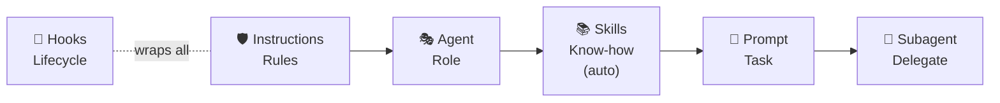

# Overview


<!-- AUTO:start version -->
Welcome to **copilot-hub** v1.0.22 👋
<!-- AUTO:end version -->

> **📌 Scope & Version Notice**
>
> This documentation summarizes and complements the official **GitHub Copilot** docs.
> It is **not a replacement** for the official documentation.
>
> **Copilot CLI version referenced:** `1.0.17`
> **Last reviewed against:** [GitHub Copilot Customization Cheat Sheet](https://docs.github.com/en/copilot/reference/customization-cheat-sheet)
>
> Always consult the [official GitHub Copilot documentation](https://docs.github.com/en/copilot) for the authoritative and most current information.

This repository is a **shared reference, documentation hub, and template library** for using **GitHub Copilot** effectively and responsibly across teams and projects.

It is designed to help developers, teams, and organizations:

- Understand how GitHub Copilot works
- Learn the key concepts (Prompts, Instructions, Agents)
- Reuse proven templates instead of starting from scratch
- Establish consistent, high‑quality AI‑assisted workflows

---

## 📖 Official GitHub Docs Reference

This repository summarizes the following official resources. When in doubt, these are the authoritative sources:

| Topic                      | Official GitHub Docs                                                                                                  |
| :------------------------- | :-------------------------------------------------------------------------------------------------------------------- |
| **Customization overview** | [Copilot customization cheat sheet](https://docs.github.com/en/copilot/reference/customization-cheat-sheet)           |
| **Custom instructions**    | [About customizing responses](https://docs.github.com/en/copilot/concepts/prompting/response-customization)           |
| **Prompt files**           | [About prompt files](https://docs.github.com/en/copilot/concepts/prompting/response-customization#about-prompt-files) |
| **Custom agents**          | [About custom agents](https://docs.github.com/en/copilot/concepts/agents/coding-agent/about-custom-agents)            |
| **Agent skills**           | [About agent skills](https://docs.github.com/en/copilot/concepts/agents/about-agent-skills)                           |
| **Subagents**              | [Using subagents](https://docs.github.com/en/copilot/how-tos/chat-with-copilot/chat-in-ide#using-subagents)           |
| **Hooks**                  | [About hooks](https://docs.github.com/en/copilot/concepts/agents/coding-agent/about-hooks)                            |
| **Copilot CLI**            | [About GitHub Copilot CLI](https://docs.github.com/en/copilot/concepts/agents/about-copilot-cli)                      |
| **MCP servers**            | [About MCP](https://docs.github.com/en/copilot/concepts/context/mcp)                                                  |

---

## What Problem Does This Repository Solve?

GitHub Copilot is powerful, but **its effectiveness depends heavily on how it is configured and used**.

Common challenges include:

- Unclear differences between prompts, instructions, and agents
- Repeating the same long prompts over and over
- Inconsistent AI behavior across projects or teams
- Overly generic or unsafe Copilot suggestions
- Lack of shared best practices

This repository addresses those challenges by providing:

- ✅ Clear documentation
- ✅ Reusable, version‑controlled templates
- ✅ Review checklists and guidelines
- ✅ A shared mental model for Copilot usage
- ✅ Support for JetBrains AI (Junie)

---

## What You’ll Find in This Repository

### 1. Documentation (`docs/`)

The `docs/` folder explains **how and why** to use GitHub Copilot features.

**Concepts**

- [Prompts](concepts/prompts.md): What prompts are and when to use them · [↗ GitHub Docs](https://docs.github.com/en/copilot/concepts/prompting/response-customization)
- [Instructions](concepts/instructions.md): What instructions are and how scoping works · [↗ GitHub Docs](https://docs.github.com/en/copilot/concepts/prompting/response-customization)
- [Agents](concepts/agents.md): What agents are and how they differ from prompts · [↗ GitHub Docs](https://docs.github.com/en/copilot/concepts/agents/coding-agent/about-custom-agents)
- [AGENTS.md](concepts/agents-md.md): Repository context files for AI coding assistants · [↗ GitHub Docs](https://docs.github.com/en/copilot/concepts/prompting/response-customization)
- [Skills](concepts/skills.md): Specialized instructions Copilot loads automatically when relevant · [↗ GitHub Docs](https://docs.github.com/en/copilot/concepts/agents/about-agent-skills)
- [Subagents](concepts/subagents.md): Isolated agents for delegated subtasks · [↗ GitHub Docs](https://docs.github.com/en/copilot/how-tos/chat-with-copilot/chat-in-ide#using-subagents)
- [Hooks](concepts/hooks.md): Shell commands at agent lifecycle events · [↗ GitHub Docs](https://docs.github.com/en/copilot/concepts/agents/coding-agent/about-hooks)
- [Plugins](concepts/plugins.md): Installable bundles of agents, skills, and instructions
- [How all concepts work together](concepts/mental-model.md)
- [copilot-workspace: Setup & Sync](sync/copilot-workspace.md)

**Usage Guides**

- [How to use prompts in daily development](usage/how-to-use-prompts.md)
- [How instructions influence Copilot behavior](usage/how-to-use-instructions.md)
- [How and when to switch agents](usage/how-to-use-agents.md)
- [Common Copilot‑assisted workflows](usage/common-workflows.md)

**Best Practices**

- [Writing effective prompts](best-practices/writing-effective-prompts.md)
- [Designing stable instructions](best-practices/writing-good-instructions.md)
- [Creating safe, useful agents](best-practices/designing-agents.md)
- [Do’s and don’ts for AI‑assisted development](best-practices/do-and-dont.md)
- **Copilot Workspace (Setup & Sync)**
  - [copilot-workspace plugin: setup wizard, sync, and standalone script](sync/copilot-workspace.md)
- **JetBrains AI Support**
  - [How Junie uses Copilot templates](jetbrains-ai.md)

**Checklists**

- [Instructions Review Checklist](checklists/instructions-review-checklist.md)
- [Prompt Review Checklist](checklists/prompt-review-checklist.md)

---

### 2. Copilot CLI Plugin Marketplace (`plugins/`)

The `plugins/` directory contains **installable plugin bundles** — curated sets of agents, skills, and instructions for a specific domain. Plugins are consumed directly by the Copilot CLI.

Available plugins: [`angular-development`](../plugins/angular-development/plugin.config.yml), [`copilot-workspace`](../plugins/copilot-workspace/plugin.config.yml), [`csharp-development`](../plugins/csharp-development/plugin.config.yml), [`devops`](../plugins/devops/plugin.config.yml), [`docker`](../plugins/docker/plugin.config.yml), [`go-development`](../plugins/go-development/plugin.config.yml), [`helm-development`](../plugins/helm-development/plugin.config.yml), [`playwright`](../plugins/playwright/plugin.config.yml), [`python-development`](../plugins/python-development/plugin.config.yml), [`security`](../plugins/security/plugin.config.yml), [`terraform-development`](../plugins/terraform-development/plugin.config.yml), [`typescript-node-development`](../plugins/typescript-node-development/plugin.config.yml)

See the [Plugin Marketplace](../README.md#-plugin-marketplace) and the [Plugin Concepts doc](concepts/plugins.md) for installation and creation details.

---

### 3. Copilot Configuration Templates (`templates/`)

The `templates/` directory contains **working, reusable configuration files** that GitHub Copilot can consume directly (or serve as examples).

Templates are organized by **domain** (e.g., `csharp/`, `python/`, `devops/`, etc.) and use compound extensions:

- `<domain>/*.instructions.md` — scoped coding standards (e.g., `csharp/csharp.instructions.md`)
- `<domain>/*.skill.md` — task-specific skills for the Copilot CLI
- `<domain>/*.prompt.md` — reusable prompts exposed as VS Code slash commands
- `<domain>/*.agent.md` — custom agents defining specialized roles

Available domains: `angular`, `csharp`, `copilot`, `devops`, `docker`, `go`, `helm`, `playwright`, `postgresql`, `python`, `security`, `shared`, `terraform`, `typescript`

These files are intended to be:

- Copied into other repositories
- Installed as part of a plugin bundle
- Adapted to specific technology stacks
- Extended through pull requests

---

### 4. Examples (`examples/`)

The `examples/` directory provides **illustrative usage examples** without being production‑critical.

Examples include:

- How to invoke prompts
- How instructions are scoped and combined
- How agents are selected and used

This section is especially useful for **onboarding**, **training**, and **documentation reviews**.

---

## Core Concepts at a Glance

| Concept      | Purpose                                   | Applied When               | GitHub Docs                                                                                   |
| :----------- | :---------------------------------------- | :------------------------- | :-------------------------------------------------------------------------------------------- |
| Instructions | Persistent project rules                  | Automatically              | [↗](https://docs.github.com/en/copilot/concepts/prompting/response-customization)             |
| Prompts      | Task‑specific workflows                   | Manually (`/`)             | [↗](https://docs.github.com/en/copilot/concepts/prompting/response-customization)             |
| Agents       | Specialized roles & permissions           | Manually (`@`)             | [↗](https://docs.github.com/en/copilot/concepts/agents/coding-agent/about-custom-agents)      |
| Skills       | Specialized know-how loaded when relevant | Auto (context) or explicit | [↗](https://docs.github.com/en/copilot/concepts/agents/about-agent-skills)                    |
| Subagents    | Delegated subtasks in isolated context    | Auto (agent) or explicit   | [↗](https://docs.github.com/en/copilot/how-tos/chat-with-copilot/chat-in-ide#using-subagents) |
| Hooks        | Shell commands at lifecycle events        | Automatically (events)     | [↗](https://docs.github.com/en/copilot/concepts/agents/coding-agent/about-hooks)              |
| Plugins      | Installable bundles (agents, skills, …)   | On install                 |                                                                                               |
| AGENTS.md    | Repository context for AI tools           | Automatically              | [↗](https://docs.github.com/en/copilot/concepts/prompting/response-customization)             |

**Mental model**


<details>
<summary>Diagram source (Mermaid)</summary>



</details>

## Who Is This Repository For?

This repository is useful for:

- Individual developers who want structured Copilot usage
- Teams establishing shared AI workflows
- Platform or enablement teams
- Organizations standardizing Copilot adoption
- Anyone reviewing or governing AI‑assisted development

No specific programming language or framework is assumed.

---

## How to Use This Repository

You can use this repository in multiple ways:

1. **As documentation**
   Read and reference it to understand Copilot concepts and best practices.

2. **As a template library**
   Copy prompts, instructions, or agents into your own repositories from `templates/`.

3. **As a plugin marketplace**
   Register copilot-hub as a custom marketplace and install domain-specific plugin bundles:
   ```bash
   gh copilot plugin marketplace add GravionLabs/copilot-hub
   gh copilot plugin install csharp-development@copilot-hub
   ```

4. **As a starting point**
   Fork the repository and adapt it for your organization or team.

5. **As a contribution base**
   Add new templates, improve existing ones, or extend documentation via pull requests.

---

## Guiding Principles

This repository follows a few core principles:

- ✅ Clarity over cleverness
- ✅ Reusability over specialization
- ✅ Safety over convenience
- ✅ Explicitness over assumptions
- ✅ Human control over automation

GitHub Copilot is a **developer assistant**, not a decision maker.

---

## Where to Go Next

- Start with `docs/concepts/prompts.md`, `instructions.md`, and `agents.md`
- **[Browse All Templates](template-list.md)** — all agents, skills, prompts, instructions by domain
- **[Browse All Skills](skill-list.md)** — skills by domain
- **[Browse All Agents](agent-list.md)** — agents by domain
- **[Browse All Instructions](instruction-list.md)** — instructions by domain
- **[Browse All Plugins](plugin-list.md)** — or install via `gh copilot plugin marketplace add GravionLabs/copilot-hub`
- Review the templates in `templates/`
- Explore the review checklists in `docs/checklists/`
- Set up and sync templates using [copilot-workspace](sync/copilot-workspace.md)
- Read `CONTRIBUTING.md` if you want to add or improve content

---

## Scope & Disclaimer

This repository:

- **Summarizes** the official GitHub Copilot documentation — it is **not a replacement**
- Is maintained against **GitHub Copilot CLI 1.0.17** (see version notice at the top)
- Does **not** enforce rules automatically
- Provides **guidance and templates**, not guarantees
- May lag behind official docs — always verify against [docs.github.com/en/copilot](https://docs.github.com/en/copilot)

Always review Copilot output and apply professional judgment.

---

We hope this repository helps you and your team get **more consistent, safer, and more effective results** from GitHub Copilot 🚀
